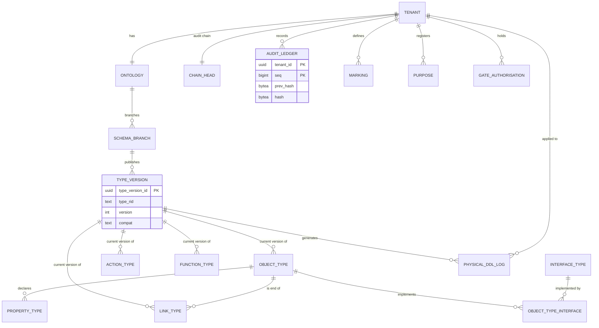
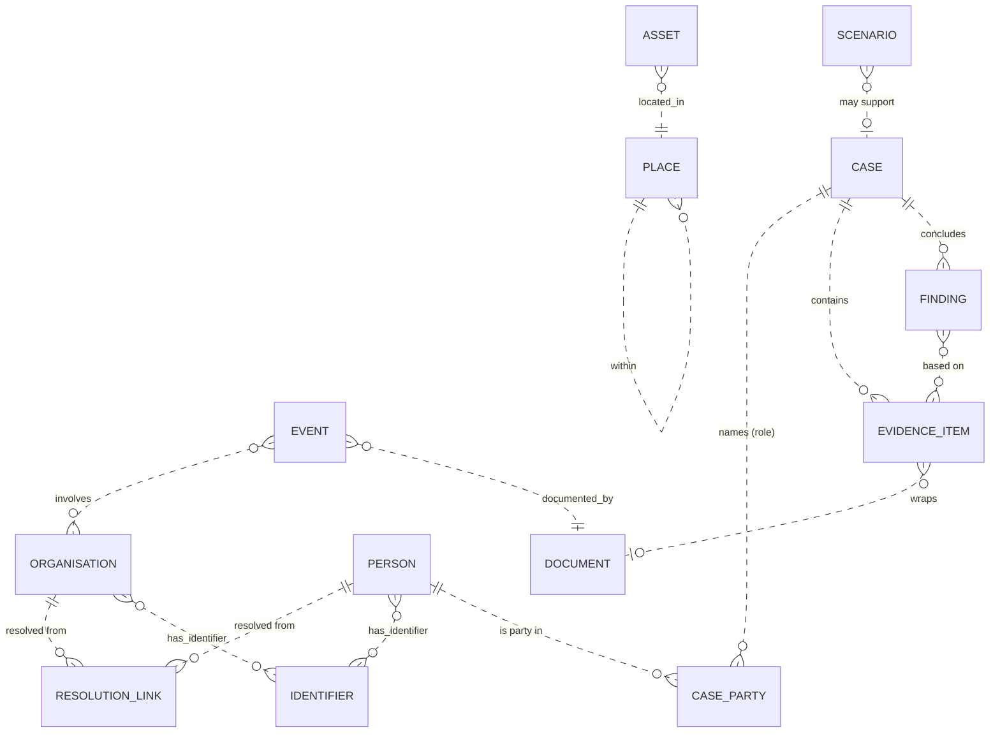
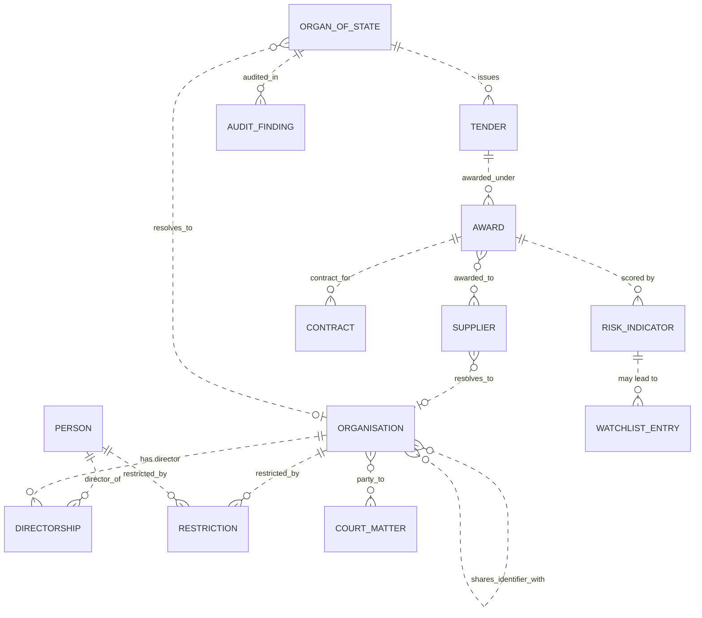
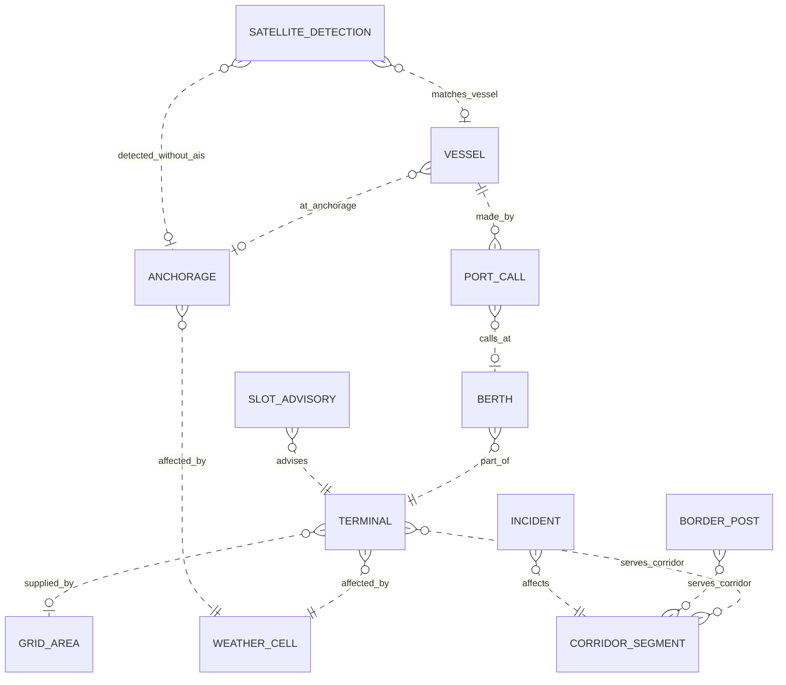

<!-- Written by Kone Tshivhinda (Claude Opus 5.5) on 2026-09-25 — Frozen database design: control plane vs tenant databases, DDL, RLS, ERDs, vectors, geo, Iceberg, OpenSearch, ClickHouse, Valkey, residency, migrations (P0) -->

# Vigil — Data Model

> **Status:** 🧊 FROZEN at P0 (v1.0, 2026-09-25). Changes only through an ADR (INSTRUCTIONS.md §4.1, PHASES Rule 10).
> **Scope:** the complete physical design behind [`ARCHITECTURE.md`](ARCHITECTURE.md) §5 (stores) and the logical model in [`VIGIL_DOMAIN_BLUEPRINT.md`](VIGIL_DOMAIN_BLUEPRINT.md). Logical and physical schemas are separate (A3). OMS *generates* per-type DDL from the templates frozen here; nobody hand-writes object tables.
> **Engines:** PostgreSQL 18, forward-compatible with 19 (PostGIS, pgvector, pgvectorscale) · Apache Iceberg v3 + Apache Polaris on the S3 API (SeaweedFS on-prem) · OpenSearch · ClickHouse · Valkey. Every code block names its target database in its first line.
> **Verification:** every PostgreSQL block in this document was executed at P0 against a scratch PostgreSQL 16 server. Stand-ins were used for `uuidv7()` (PG 18), PostGIS and pgvector types; GiST and HNSW indexes were skipped. A functional suite checked the RLS filtering, forged-context rejection, masking, partition bypass, the W8 guard, edit-log immutability and erasure, separation of duties, audit immutability and the s71 check. P3/P5/P8 recreate and re-run it on PG 18 with the real extensions as part of their "Done when" (the P0 suite was not committed; AI_COMMUNICATION MSG-023).
> **Examples** use the fictional tenant `demo`.

## 1. Principles and conventions

1. **Security pushdown.** Every store that serves reads enforces Warden natively: Postgres RLS, OpenSearch DLS/FLS, Polaris-vended scoped credentials, ClickHouse row policies (ARCHITECTURE §5).
2. **Edits are events.** `actions.edit_log` is the source of truth for ontology edits. Typed rows are projections (A4). Source history lives in Iceberg snapshots.
3. **One schema owner per table.** Where two services write the same rows (typed object tables), they write disjoint duties under the merge protocol (§4.4).
4. **Names.**
   - snake_case everywhere.
   - Object tables `objects.ot_<type>`, join tables `objects.lt_<link>`, masking views `objects_v.<type>`, embeddings `objects.emb_<type>__<model>`.
   - Identifiers are at most 63 bytes. Longer names are shortened to 54 characters plus `_` and 8 hex characters of their SHA-256.
5. **Types.**
   - System ids are UUIDv7 (`uuidv7()`, PG 18). Object RIDs are UUIDv5 (§4.3).
   - Times are `timestamptz` in UTC.
   - Money is `numeric(38,2)` plus an ISO 4217 currency column.
6. **Principals** are typed strings: `user:<keycloak-sub>`, `svc:<service>`, `agent:<session-id>`.
7. **Reserved column names.** OMS rejects properties that collide with them: `pk, rid, markings, classification, releasability, purpose_tags, source_id, source_record_id, connector_version, fetched_at, terms_ref, responsible_party, lawful_basis, data_origin, dataset_rid, dataset_txn_id, content_sha256, edited_props, last_edit_seq, valid_from, updated_at, version, deleted_at, redacted_properties`.
8. **Label encoding** (Blueprint §4):
   - `markings text[]`: an empty array means no markings;
   - `classification smallint` (0–4);
   - `releasability text[]` and `purpose_tags text[]`: an empty array means ⊤ (unrestricted).

## 2. Database topology

| Database | Cluster | Schemas (owner phase) | Holds |
|---|---|---|---|
| `vigil_control` | Control-plane cluster, one per residency pod | `tenancy` (P5), `oms` (P5), `audit` (P3), `warden` (P3), `openfga` (OpenFGA-managed, P3), `relay` (P21) | Tenants, OMS metadata, type versions, schema branches, action and function types, audit ledger, Warden registry, OpenFGA store, Relay state |
| `vigil_t_<slug>` | Tenant cluster in the tenant's pod | `objects`, `objects_v` (generated by P5), `actions` (P8), `vigil_sec` (P3) | Typed object tables, join tables, edit log, outbox, action runs, approvals |
| `temporal`, `temporal_visibility` | Control-plane cluster | Temporal-managed (P8) | Saga state |
| `keycloak` · `polaris` · `vigil_mind` | Control-plane cluster | Keycloak (P3) · Polaris (P4) · Mind registry, quotas and agent sessions (P14, P15) | Service-private stores |
| `vigil_odbl` | Separate instance | Basemap import (P18) | OSM/Overture ODbL layers, kept apart (dossier §11) |

**Rules:**
- **A schema has exactly one owning service**, and each service has its own role. There are no cross-schema grants between services, except narrow read-only column grants that security guards need, each listed in the §2 matrix. Otherwise services integrate through contracts only. This keeps ARCHITECTURE §5, which lists Java, Go and Rust writers into shared *databases*, consistent with A7: the shared unit is the server, never a schema or table (see §2 matrix).
- **Tenant isolation is one database per tenant.** Per-tenant login roles (`demo_reader`, …) are members of shared NOLOGIN group roles, and `CONNECT` is granted only on their own database, so a misrouted request fails authentication. Inside a tenant, markings are enforced by RLS.
- **Placement:** small tenants share a tenant cluster; sovereign or large tenants get a dedicated cluster, keyed by the tenant's `kms_key_ref`. Poolers run in transaction mode, which `SET LOCAL` is compatible with.

**Write-ownership matrix** (the only multi-writer family is `objects.*`):

| Table family | Schema owner (DDL) | Row writers | Readers |
|---|---|---|---|
| `objects.ot_*`, `objects.lt_*` | P5 generator (Java) | Indexer, P6 (Rust): source-derived rows. Action engine, P8 (Java): edits. Both under §4.4 | OSS (P7) through `objects_v`; traversal (P7) through column grants; Action engine |
| `actions.*` | P8 | Action engine; outbox relay (`published_at` only); erasure functions (§6.3) | Action engine, OSS (history, under RLS), exporters. **Guard exception:** `vigil_sec_owner` reads `action_run(action_run_id, action_type, status, parameters)` for the W8 guard |
| `oms.*` · `audit.*` · `warden.*` | P5 · P3 · P3 | OMS · the audit chainer (single writer per tenant chain) · Warden admin | core modules · audit API, P40 verifier · `warden-pdp` |

## 3. Control-plane schema (`vigil_control`)

Migrations: `services/core/src/main/resources/db/migration/{shared,ontology,audit}/control/` (§15). The `warden` schema comes from `services/warden/sql/control/` (P3).

### 3.0 Cluster bootstrap (P1/P3 provisioning; roles are cluster-wide)

```sql
-- db: cluster bootstrap. Group roles are NOLOGIN; per-tenant and per-service login roles are members.
CREATE ROLE vigil_owner NOLOGIN;          -- owns tenant objects; never used by a running service
CREATE ROLE vigil_ddl NOLOGIN;            -- OMS DDL generator (SET ROLE vigil_owner inside the DDL transaction)
CREATE ROLE vigil_reader NOLOGIN;         -- Object Set Service
CREATE ROLE vigil_actions NOLOGIN;        -- Action engine
CREATE ROLE vigil_indexer NOLOGIN;        -- indexer: system writer, never serves user reads
CREATE ROLE vigil_traversal NOLOGIN;      -- traversal snapshots: label and key columns only
CREATE ROLE vigil_outbox_relay NOLOGIN;
CREATE ROLE vigil_sec_owner NOLOGIN;      -- owns vigil_sec (policy-context verification, key table)
CREATE ROLE vigil_erasure_owner NOLOGIN;  -- owns the erasure functions: the only UPDATE path into edit_log, DELETE path from objects
CREATE ROLE vigil_erasure_saga NOLOGIN;   -- the erasure saga's worker: may only call the erasure functions
CREATE ROLE vigil_oms NOLOGIN;
CREATE ROLE vigil_audit_chainer NOLOGIN;
CREATE ROLE vigil_audit_reader NOLOGIN;
GRANT vigil_owner TO vigil_ddl;
```

### 3.1 Tenancy

```sql
-- db: vigil_control · services/warden/sql/control/V3_000__create_tenancy.sql (P3; applied first, §15; P5 references it)
CREATE SCHEMA tenancy;
CREATE TABLE tenancy.tenant (
  tenant_id uuid PRIMARY KEY DEFAULT uuidv7(),
  slug text NOT NULL UNIQUE CHECK (slug ~ '^[a-z][a-z0-9]{2,29}$'),
  display_name text NOT NULL,
  country char(2) NOT NULL CHECK (country ~ '^[A-Z]{2}$'),
  residency_pod text NOT NULL CHECK (residency_pod ~ '^[a-z]{2}-[a-z]{2}-[0-9]+$'),           -- e.g. za-gp-1
  deployment_tier text NOT NULL CHECK (deployment_tier IN ('SOVEREIGN','ON_PREM','AIR_GAPPED','EDGE','COMMERCIAL')),
  max_classification smallint NOT NULL DEFAULT 2 CHECK (max_classification BETWEEN 0 AND 4),
  db_name text GENERATED ALWAYS AS ('vigil_t_' || slug) STORED,
  kms_key_ref text NOT NULL,                                     -- a KMS/HSM key reference, never key material
  status text NOT NULL DEFAULT 'PROVISIONING' CHECK (status IN ('PROVISIONING','ACTIVE','SUSPENDED','OFFBOARDING','DELETED')),
  created_at timestamptz NOT NULL DEFAULT now()
);
```

### 3.2 Ontologies, schema branches and immutable type versions

```sql
-- db: vigil_control · db/migration/ontology/control/V5_002__create_oms_versions.sql
CREATE SCHEMA oms;
CREATE TABLE oms.ontology (
  ontology_id uuid PRIMARY KEY DEFAULT uuidv7(),
  tenant_id uuid NOT NULL UNIQUE REFERENCES tenancy.tenant (tenant_id),     -- one ontology per tenant (v1)
  rid text NOT NULL UNIQUE, created_at timestamptz NOT NULL DEFAULT now()
);
CREATE TABLE oms.schema_branch (
  branch_id uuid PRIMARY KEY DEFAULT uuidv7(),
  ontology_id uuid NOT NULL REFERENCES oms.ontology (ontology_id),
  name text NOT NULL CHECK (name ~ '^(main|[a-z0-9][a-z0-9-]{1,40})$'),
  parent_branch_id uuid REFERENCES oms.schema_branch (branch_id),
  forked_at_seq bigint,                                          -- parent's publish_seq at fork
  dataset_branch text NOT NULL,                                  -- 'main' or 'vb-<name>' (§9)
  status text NOT NULL DEFAULT 'OPEN' CHECK (status IN ('OPEN','MERGED','ABANDONED')),
  created_by text NOT NULL CHECK (created_by ~ '^(user|svc):'),
  created_at timestamptz NOT NULL DEFAULT now(), merged_at timestamptz,
  UNIQUE (ontology_id, name),
  CHECK ((name = 'main') = (parent_branch_id IS NULL))
);
CREATE TABLE oms.type_version (
  type_version_id uuid PRIMARY KEY DEFAULT uuidv7(),
  ontology_id uuid NOT NULL REFERENCES oms.ontology (ontology_id),
  branch_id uuid NOT NULL REFERENCES oms.schema_branch (branch_id),
  type_rid text NOT NULL,                                        -- stable across versions
  type_kind text NOT NULL CHECK (type_kind IN ('OBJECT','LINK','INTERFACE','ACTION','FUNCTION','VALUE')),
  api_name text NOT NULL,
  version integer NOT NULL CHECK (version >= 1),
  publish_seq bigint GENERATED ALWAYS AS IDENTITY,               -- total order of publishes
  compat text NOT NULL CHECK (compat IN ('INITIAL','COMPATIBLE','BREAKING')),
  definition jsonb NOT NULL,                                     -- canonical (RFC 8785) pack definition
  definition_sha256 bytea NOT NULL CHECK (octet_length(definition_sha256) = 32),
  migration_plan jsonb, pack_name text, pack_version text,
  published_by text NOT NULL CHECK (published_by ~ '^(user|svc):'),
  published_at timestamptz NOT NULL DEFAULT now(),
  UNIQUE (type_rid, branch_id, version),
  CHECK (compat <> 'BREAKING' OR migration_plan IS NOT NULL)     -- P5 "Done when"
);
CREATE FUNCTION oms.forbid_mutation() RETURNS trigger LANGUAGE plpgsql AS $$
BEGIN
  RAISE EXCEPTION 'oms.type_version is immutable (%)', TG_OP USING ERRCODE = 'insufficient_privilege';
END $$;
CREATE TRIGGER type_version_immutable BEFORE UPDATE OR DELETE ON oms.type_version
  FOR EACH ROW EXECUTE FUNCTION oms.forbid_mutation();
```

### 3.3 Type projections (the current published definition per branch)

```sql
-- db: vigil_control · db/migration/ontology/control/V5_003__create_oms_types.sql
CREATE TABLE oms.object_type (
  object_type_id uuid PRIMARY KEY DEFAULT uuidv7(),              -- also the UUIDv5 namespace for object RIDs (§4.3)
  ontology_id uuid NOT NULL REFERENCES oms.ontology (ontology_id),
  branch_id uuid NOT NULL REFERENCES oms.schema_branch (branch_id),
  rid text NOT NULL,
  api_name text NOT NULL CHECK (api_name ~ '^[A-Z][A-Za-z0-9]{1,62}$'),
  display_name text NOT NULL,
  status text NOT NULL CHECK (status IN ('EXPERIMENTAL','ACTIVE','DEPRECATED')),
  primary_key_property text NOT NULL, title_property text NOT NULL,
  existence_policy text NOT NULL DEFAULT 'SOURCE_WINS' CHECK (existence_policy IN ('SOURCE_WINS','EDIT_WINS')),
  physical_table text NOT NULL CHECK (physical_table ~ '^ot_[a-z][a-z0-9_]{1,59}$'),
  partition_modulus smallint NOT NULL DEFAULT 1 CHECK (partition_modulus IN (1,16,32,64)),
  default_markings text[] NOT NULL DEFAULT '{}',
  default_classification smallint NOT NULL DEFAULT 0 CHECK (default_classification BETWEEN 0 AND 4),
  current_version_id uuid NOT NULL REFERENCES oms.type_version (type_version_id),
  UNIQUE (ontology_id, branch_id, api_name), UNIQUE (ontology_id, branch_id, rid)
);
CREATE TABLE oms.property_type (
  property_type_id uuid PRIMARY KEY DEFAULT uuidv7(),
  object_type_id uuid NOT NULL REFERENCES oms.object_type (object_type_id) ON DELETE RESTRICT,
  api_name text NOT NULL CHECK (api_name ~ '^[a-z][a-z0-9_]{0,62}$'),
  base_type text NOT NULL CHECK (base_type IN ('boolean','integer','long','double','decimal','string','date','timestamp',
    'struct','geopoint','geoshape','time_series','geotemporal_series','vector','media_reference','cipher_text','marking')),
  is_array boolean NOT NULL DEFAULT false,
  value_type text,                                               -- e.g. 'za.sa_id_number', 'vigil.object_rid'
  physical_column text NOT NULL CHECK (physical_column ~ '^[a-z][a-z0-9_]{0,62}$'),
  nullable boolean NOT NULL DEFAULT true,
  editable boolean NOT NULL DEFAULT false,
  conflict_policy text CHECK (conflict_policy IN ('SOURCE_WINS','EDIT_WINS','LATEST_TIMESTAMP')),
  column_markings text[] NOT NULL DEFAULT '{}',
  column_classification smallint NOT NULL DEFAULT 0 CHECK (column_classification BETWEEN 0 AND 4),
  searchable boolean NOT NULL DEFAULT false,
  vector_dimension integer CHECK (vector_dimension BETWEEN 1 AND 2000), embedding_model text,
  introduced_in integer NOT NULL, retired_in integer,
  UNIQUE (object_type_id, api_name), UNIQUE (object_type_id, physical_column),
  CHECK (editable = (conflict_policy IS NOT NULL)),              -- Blueprint §1.9: every editable property declares one
  CHECK (NOT (is_array AND base_type IN ('vector','time_series','geotemporal_series'))),
  CHECK ((base_type = 'vector') = (vector_dimension IS NOT NULL AND embedding_model IS NOT NULL)),
  CHECK (physical_column NOT IN ('pk','rid','markings','classification','releasability','purpose_tags','source_id',
    'source_record_id','connector_version','fetched_at','terms_ref','responsible_party','lawful_basis','data_origin',
    'dataset_rid','dataset_txn_id','content_sha256','edited_props','last_edit_seq','valid_from','updated_at','version',
    'deleted_at','redacted_properties'))
);
CREATE TABLE oms.link_type (
  link_type_id uuid PRIMARY KEY DEFAULT uuidv7(),
  ontology_id uuid NOT NULL REFERENCES oms.ontology (ontology_id),
  branch_id uuid NOT NULL REFERENCES oms.schema_branch (branch_id),
  rid text NOT NULL,
  api_name text NOT NULL CHECK (api_name ~ '^[a-z][a-z0-9_]{1,62}$'),
  inverse_api_name text NOT NULL CHECK (inverse_api_name ~ '^[a-z][a-z0-9_]{1,62}$'),
  cardinality text NOT NULL CHECK (cardinality IN ('ONE_TO_ONE','MANY_TO_ONE','MANY_TO_MANY','OBJECT_BACKED')),
  a_object_type_id uuid NOT NULL REFERENCES oms.object_type (object_type_id),
  b_object_type_id uuid NOT NULL REFERENCES oms.object_type (object_type_id),
  fk_property_id uuid REFERENCES oms.property_type (property_type_id),          -- 1:1 and N:1 (FK on side A)
  join_table text CHECK (join_table ~ '^lt_[a-z][a-z0-9_]{1,59}$'),              -- M:N
  backing_object_type_id uuid REFERENCES oms.object_type (object_type_id),      -- object-backed
  datasource_rid text,
  link_markings text[] NOT NULL DEFAULT '{}',
  status text NOT NULL CHECK (status IN ('EXPERIMENTAL','ACTIVE','DEPRECATED')),
  current_version_id uuid NOT NULL REFERENCES oms.type_version (type_version_id),
  UNIQUE (ontology_id, branch_id, api_name),
  CHECK ((cardinality IN ('ONE_TO_ONE','MANY_TO_ONE') AND fk_property_id IS NOT NULL AND join_table IS NULL AND backing_object_type_id IS NULL)
      OR (cardinality = 'MANY_TO_MANY' AND join_table IS NOT NULL AND fk_property_id IS NULL AND backing_object_type_id IS NULL)
      OR (cardinality = 'OBJECT_BACKED' AND backing_object_type_id IS NOT NULL AND fk_property_id IS NULL AND join_table IS NULL))
);
CREATE UNIQUE INDEX link_type_one_datasource ON oms.link_type (branch_id, datasource_rid) WHERE datasource_rid IS NOT NULL;
CREATE TABLE oms.interface_type (
  interface_type_id uuid PRIMARY KEY DEFAULT uuidv7(),
  ontology_id uuid NOT NULL REFERENCES oms.ontology (ontology_id),
  branch_id uuid NOT NULL REFERENCES oms.schema_branch (branch_id),
  rid text NOT NULL, api_name text NOT NULL CHECK (api_name ~ '^[A-Z][A-Za-z0-9]{1,62}$'),
  shared_properties jsonb NOT NULL,
  current_version_id uuid NOT NULL REFERENCES oms.type_version (type_version_id),
  UNIQUE (ontology_id, branch_id, api_name)
);
CREATE TABLE oms.object_type_interface (
  object_type_id uuid NOT NULL REFERENCES oms.object_type (object_type_id),
  interface_type_id uuid NOT NULL REFERENCES oms.interface_type (interface_type_id),
  property_map jsonb NOT NULL,                                   -- interface property -> object property
  PRIMARY KEY (object_type_id, interface_type_id)
);
CREATE TABLE oms.action_type (
  action_type_id uuid PRIMARY KEY DEFAULT uuidv7(),
  ontology_id uuid NOT NULL REFERENCES oms.ontology (ontology_id),
  branch_id uuid NOT NULL REFERENCES oms.schema_branch (branch_id),
  rid text NOT NULL,
  api_name text NOT NULL CHECK (api_name ~ '^[a-z][a-z0-9-]{1,62}$'),
  display_name text NOT NULL,
  status text NOT NULL CHECK (status IN ('EXPERIMENTAL','ACTIVE','DEPRECATED')),
  outcome_class text NOT NULL CHECK (outcome_class IN ('INFORMATIONAL','OPERATIONAL','ADVERSE','LEGAL_EFFECT')),
  requires_human_approval boolean NOT NULL,
  agent_executable boolean NOT NULL DEFAULT false,
  justification_required boolean NOT NULL DEFAULT false,
  case_scoped boolean NOT NULL DEFAULT false,
  allowed_purposes text[] NOT NULL,
  has_writeback_webhook boolean NOT NULL DEFAULT false,
  webhook_timeout_ms integer CHECK (webhook_timeout_ms BETWEEN 100 AND 10000),
  max_objects integer NOT NULL DEFAULT 10000 CHECK (max_objects BETWEEN 1 AND 10000),
  max_object_types smallint NOT NULL DEFAULT 50 CHECK (max_object_types BETWEEN 1 AND 50),
  sync_budget_ms integer NOT NULL DEFAULT 60000 CHECK (sync_budget_ms BETWEEN 1000 AND 60000),
  current_version_id uuid NOT NULL REFERENCES oms.type_version (type_version_id),
  UNIQUE (ontology_id, branch_id, api_name),
  CHECK (outcome_class NOT IN ('ADVERSE','LEGAL_EFFECT') OR requires_human_approval),   -- POPIA s71
  CHECK (has_writeback_webhook = (webhook_timeout_ms IS NOT NULL)),
  CHECK (cardinality(allowed_purposes) >= 1)
);
CREATE TABLE oms.function_type (
  function_type_id uuid PRIMARY KEY DEFAULT uuidv7(),
  ontology_id uuid NOT NULL REFERENCES oms.ontology (ontology_id),
  branch_id uuid NOT NULL REFERENCES oms.schema_branch (branch_id),
  rid text NOT NULL, api_name text NOT NULL CHECK (api_name ~ '^[a-z][a-z0-9-]{1,62}$'),
  language text NOT NULL CHECK (language IN ('TYPESCRIPT','PYTHON','WASM')),
  kind text NOT NULL CHECK (kind IN ('QUERY','EDITS')),
  artefact_sha256 bytea NOT NULL CHECK (octet_length(artefact_sha256) = 32),
  input_schema jsonb NOT NULL, output_schema jsonb NOT NULL,
  timeout_ms integer NOT NULL DEFAULT 60000 CHECK (timeout_ms BETWEEN 100 AND 60000),
  memory_mb integer NOT NULL DEFAULT 512 CHECK (memory_mb BETWEEN 16 AND 4096),
  current_version_id uuid NOT NULL REFERENCES oms.type_version (type_version_id),
  UNIQUE (ontology_id, branch_id, api_name)
);
CREATE INDEX property_type_object_idx ON oms.property_type (object_type_id);
CREATE INDEX link_type_a_idx ON oms.link_type (a_object_type_id);
CREATE INDEX link_type_b_idx ON oms.link_type (b_object_type_id);
```

### 3.4 Physical DDL journal

OMS applies generated DDL to each tenant database in one transaction per type version, and records it here. It is idempotent, forward-only and checksummed.

```sql
-- db: vigil_control · db/migration/ontology/control/V5_004__create_ddl_journal.sql
CREATE TABLE oms.physical_ddl_log (
  ddl_id uuid PRIMARY KEY DEFAULT uuidv7(),
  tenant_id uuid NOT NULL REFERENCES tenancy.tenant (tenant_id),
  type_version_id uuid NOT NULL REFERENCES oms.type_version (type_version_id),
  statements text NOT NULL,
  statements_sha256 bytea NOT NULL CHECK (octet_length(statements_sha256) = 32),
  status text NOT NULL CHECK (status IN ('PENDING','APPLIED','FAILED')),
  applied_at timestamptz,
  UNIQUE (tenant_id, type_version_id)
);
```

### 3.5 Audit ledger (hash-chained, append-only)

- **One chain per tenant.** The platform uses the reserved tenant slug `platform`.
- Services write to `audit_inbox`. A **single chainer per tenant** (leadership by Postgres advisory lock) assigns a gap-free `seq`, sets `recorded_at`, and computes:
  - `hash = SHA-256(prev_hash ‖ JCS(event))`, where JCS(event) covers every column from `tenant_id` to `policy_version`;
  - `signature = Ed25519(hash)`, with the key in KMS/OpenBao in v1 and the HSM from P42.
- The genesis `prev_hash` is `SHA-256("vigil-audit-genesis:" ‖ tenant_id)`.
- **Events never carry property values.**
- Monthly partitions are exported to Iceberg and anchored (P40) before they are detached. Each detach writes a checkpoint hash, so verification can start from a checkpoint.

```sql
-- db: vigil_control · db/migration/audit/control/V3_001__create_audit_ledger.sql
CREATE SCHEMA audit;
CREATE TABLE audit.chain_head (
  tenant_id uuid PRIMARY KEY REFERENCES tenancy.tenant (tenant_id),
  last_seq bigint NOT NULL DEFAULT 0, last_hash bytea NOT NULL CHECK (octet_length(last_hash) = 32)
);
CREATE TABLE audit.audit_inbox (
  inbox_id bigint GENERATED ALWAYS AS IDENTITY PRIMARY KEY,
  tenant_id uuid NOT NULL, event jsonb NOT NULL, received_at timestamptz NOT NULL DEFAULT clock_timestamp()
);
CREATE TABLE audit.audit_ledger (
  tenant_id uuid NOT NULL,
  seq bigint NOT NULL CHECK (seq >= 1),
  recorded_at timestamptz NOT NULL,
  event_id uuid NOT NULL,
  event_type text NOT NULL,                  -- objects.query, actions.applied, policy.denied, er.linkage.locked, …
  occurred_at timestamptz NOT NULL,
  actor text NOT NULL CHECK (actor ~ '^(user|svc|agent):'),
  on_behalf_of text CHECK (on_behalf_of ~ '^user:'),
  purpose text, case_id text, resource_rid text,
  marking_ids text[] NOT NULL DEFAULT '{}',
  decision text NOT NULL CHECK (decision IN ('ALLOW','DENY','NOT_APPLICABLE')),
  policy_ctx_hash bytea, policy_version text,
  details jsonb NOT NULL DEFAULT '{}',       -- query hash, row count, obligations; never values
  prev_hash bytea NOT NULL CHECK (octet_length(prev_hash) = 32),
  hash bytea NOT NULL CHECK (octet_length(hash) = 32),
  signature bytea NOT NULL, signing_key_id text NOT NULL,
  PRIMARY KEY (tenant_id, seq, recorded_at), -- partition key must be in the PK; seq is unique per chain by construction
  CHECK ((actor ~ '^agent:') = (on_behalf_of IS NOT NULL))
) PARTITION BY RANGE (recorded_at);
CREATE TABLE audit.audit_ledger_2026_10 PARTITION OF audit.audit_ledger FOR VALUES FROM ('2026-10-01') TO ('2026-11-01');
CREATE INDEX audit_ledger_resource_idx ON audit.audit_ledger (tenant_id, resource_rid, recorded_at);
CREATE INDEX audit_ledger_actor_idx ON audit.audit_ledger (tenant_id, actor, recorded_at);
CREATE FUNCTION audit.forbid_mutation() RETURNS trigger LANGUAGE plpgsql AS $$
BEGIN
  RAISE EXCEPTION 'audit.audit_ledger is append-only (%)', TG_OP USING ERRCODE = 'insufficient_privilege';
END $$;
CREATE TRIGGER audit_ledger_append_only BEFORE UPDATE OR DELETE ON audit.audit_ledger
  FOR EACH ROW EXECUTE FUNCTION audit.forbid_mutation();
CREATE TRIGGER audit_ledger_no_truncate BEFORE TRUNCATE ON audit.audit_ledger
  FOR EACH STATEMENT EXECUTE FUNCTION audit.forbid_mutation();
REVOKE ALL ON audit.audit_ledger FROM PUBLIC;
GRANT INSERT, SELECT ON audit.audit_ledger TO vigil_audit_chainer;
GRANT SELECT ON audit.audit_ledger TO vigil_audit_reader;
```

### 3.6 Warden registry: markings, purposes and gated-module authorisations

```sql
-- db: vigil_control · services/warden/sql/control/V3_002__create_warden_registry.sql
CREATE SCHEMA warden;
CREATE TABLE warden.marking (
  tenant_id uuid NOT NULL REFERENCES tenancy.tenant (tenant_id),        -- platform markings are copied into each tenant
  marking_id text NOT NULL CHECK (marking_id ~ '^[A-Z][A-Z0-9-]{1,63}$'),
  category text NOT NULL CHECK (category IN ('PII','SPECIAL_PI','CHILD','CRIMINAL_CONDUCT','SECURITY_MEASURE',
                                             'CASE','ORGANISATION','PROJECT','CUSTOMER')),
  description text NOT NULL,
  required_ground text,                                  -- e.g. 'POPIA s27', 'POPIA s33', 'CIPA s26'
  keycloak_group text NOT NULL,                          -- holders = members of this group
  PRIMARY KEY (tenant_id, marking_id)
);
CREATE TABLE warden.purpose (
  tenant_id uuid NOT NULL REFERENCES tenancy.tenant (tenant_id),
  purpose_code text NOT NULL CHECK (purpose_code ~ '^[A-Z][A-Z0-9_]{2,63}$'),
  description text NOT NULL,
  lawful_basis text NOT NULL,                            -- POPIA s11 ground; s15(3) ground where relied on
  case_required boolean NOT NULL DEFAULT false,          -- hessenDATA case-predicated mode
  permitted_methods text[] NOT NULL,                     -- e.g. {QUERY,ER_ORG,RISK_SCORING,LLM_SUMMARISE}
  retention interval NOT NULL,
  publishable boolean NOT NULL DEFAULT true,             -- the deployment's rules can be disclosed
  PRIMARY KEY (tenant_id, purpose_code)
);
CREATE TABLE warden.gate_authorisation (
  authorisation_id uuid PRIMARY KEY DEFAULT uuidv7(),
  tenant_id uuid NOT NULL REFERENCES tenancy.tenant (tenant_id),
  gate text NOT NULL CHECK (gate IN ('S57_1A_LINKAGE','S57_1B_WATCHLIST','CHILD_DATA','SPECIAL_PI_TRANSFER',
                                     'COMMS_METADATA','BIOMETRIC_RETROSPECTIVE','LPR_HOTLIST','S71_LEGAL_EFFECT')),
  kind text NOT NULL CHECK (kind IN ('REGULATOR_AUTHORISATION','SECTOR_CODE','COURT_DIRECTION',
                                     'COMPETENT_PERSON_CONSENT',   -- POPIA s35(1)(a): children's data (counsel to confirm)
                                     'STATUTORY_AUTHORITY',        -- s35(1)(b) / s71(2)(b): authorised by law or code (counsel to confirm)
                                     'CONTRACT_WITH_SAFEGUARDS',   -- s71(2)(a): contract plus appropriate measures
                                     'SYNTHETIC_DATA_ONLY')),
  reference text NOT NULL,                               -- e.g. the Information Regulator's authorisation reference
  issuing_authority text,                                -- e.g. 'Information Regulator', a named court
  instrument_sha256 bytea CHECK (instrument_sha256 IS NULL OR octet_length(instrument_sha256) = 32), -- hash of the instrument document
  scope jsonb NOT NULL,                                  -- datasets, identifier kinds, purposes, responsible parties
  valid_from timestamptz NOT NULL, valid_to timestamptz NOT NULL,
  requested_by text NOT NULL CHECK (requested_by ~ '^user:'),
  approved_by_1 text NOT NULL CHECK (approved_by_1 ~ '^user:'),
  approved_by_2 text NOT NULL CHECK (approved_by_2 ~ '^user:'),
  counsel_ref text,
  status text NOT NULL DEFAULT 'ACTIVE' CHECK (status IN ('ACTIVE','SUSPENDED','EXPIRED','REVOKED')),
  created_at timestamptz NOT NULL DEFAULT now(),
  CHECK (approved_by_1 <> approved_by_2                  -- dual control: two different approvers,
     AND requested_by NOT IN (approved_by_1, approved_by_2)),   -- neither of them the requester
  CHECK (valid_to > valid_from)
);
CREATE INDEX gate_authorisation_lookup ON warden.gate_authorisation (tenant_id, gate) WHERE status = 'ACTIVE';
```

## 4. Tenant schema (`vigil_t_<slug>`)

### 4.1 Database, schemas and grants

```sql
-- db: vigil_t_demo · provisioning (per tenant). Login roles demo_reader, demo_actions, … are members of the group roles.
REVOKE CONNECT ON DATABASE vigil_t_demo FROM PUBLIC;
CREATE SCHEMA vigil_sec AUTHORIZATION vigil_sec_owner;
CREATE SCHEMA objects AUTHORIZATION vigil_owner;
CREATE SCHEMA objects_v AUTHORIZATION vigil_owner;
CREATE SCHEMA actions AUTHORIZATION vigil_owner;
CREATE EXTENSION IF NOT EXISTS pgcrypto WITH SCHEMA vigil_sec;
CREATE EXTENSION IF NOT EXISTS "uuid-ossp" WITH SCHEMA vigil_sec;
CREATE EXTENSION IF NOT EXISTS postgis;
CREATE EXTENSION IF NOT EXISTS vector;
GRANT USAGE ON SCHEMA vigil_sec TO vigil_reader, vigil_actions, vigil_indexer, vigil_traversal;
GRANT USAGE ON SCHEMA objects TO vigil_reader, vigil_actions, vigil_indexer, vigil_traversal;
GRANT USAGE ON SCHEMA objects_v TO vigil_reader;
GRANT USAGE ON SCHEMA actions TO vigil_actions, vigil_outbox_relay, vigil_reader;
```

### 4.2 The policy context: `SET LOCAL vigil.policy_ctx`

Each data-access transaction starts with the same two statements:

```text
BEGIN;
SET LOCAL vigil.policy_ctx = '<base64url(payload)>.<key_id>.<hex HMAC-SHA-256>';   -- signed by warden-pdp for this request
SELECT vigil_sec.apply_ctx();   -- verifies it, then sets vigil.user_markings, .clearance, .releasability, .purpose, .case_id locally
```

- The payload is `{"markings": […], "clearance": 2, "releasability": […], "purpose": "…", "case_id": "…", "exp": "…"}`.
- Custom settings can be set by any role, so every policy also calls `vigil_sec.ctx_ok()`. It re-verifies the signature and checks that the derived settings still match the signed payload, so a process that edits `vigil.user_markings` by hand gets zero rows.
- The key table is readable only by `vigil_sec_owner`, and the key comes from the P3 key ceremony.
- Reset settings read back as `''`, so the accessors use `NULLIF`. An unset or invalid context evaluates to NULL, which denies (W11).

```sql
-- db: vigil_t_demo · services/warden/sql/tenant/V3_001__create_vigil_sec.sql (P3)
CREATE TABLE vigil_sec.ctx_key (
  key_id text PRIMARY KEY, secret bytea NOT NULL CHECK (octet_length(secret) >= 32),
  active boolean NOT NULL DEFAULT true, created_at timestamptz NOT NULL DEFAULT now()
);
ALTER TABLE vigil_sec.ctx_key OWNER TO vigil_sec_owner;          -- no grants to any service role
CREATE FUNCTION vigil_sec.verified_payload() RETURNS jsonb
LANGUAGE plpgsql STABLE SECURITY DEFINER SET search_path = pg_catalog, vigil_sec AS $$
DECLARE tok text := NULLIF(current_setting('vigil.policy_ctx', true), ''); body text; kid text; sig text; k bytea; payload jsonb;
BEGIN
  IF tok IS NULL THEN RETURN NULL; END IF;
  body := split_part(tok, '.', 1); kid := split_part(tok, '.', 2); sig := split_part(tok, '.', 3);
  SELECT c.secret INTO k FROM vigil_sec.ctx_key c WHERE c.key_id = kid AND c.active;
  IF k IS NULL OR encode(vigil_sec.hmac(convert_to(body || '.' || kid, 'UTF8'), k, 'sha256'), 'hex') <> sig THEN RETURN NULL; END IF;
  payload := convert_from(decode(translate(body, '-_', '+/') || repeat('=', (4 - length(body) % 4) % 4), 'base64'), 'UTF8')::jsonb;
  IF (payload ->> 'exp')::timestamptz <= now() THEN RETURN NULL; END IF;
  RETURN payload;
END $$;
ALTER FUNCTION vigil_sec.verified_payload() OWNER TO vigil_sec_owner;
CREATE FUNCTION vigil_sec.apply_ctx() RETURNS void
LANGUAGE plpgsql SECURITY DEFINER SET search_path = pg_catalog, vigil_sec AS $$
DECLARE p jsonb := vigil_sec.verified_payload();
BEGIN
  IF p IS NULL THEN RAISE EXCEPTION 'invalid or expired policy context' USING ERRCODE = 'insufficient_privilege'; END IF;
  PERFORM set_config('vigil.user_markings', ARRAY(SELECT jsonb_array_elements_text(p -> 'markings'))::text, true);
  PERFORM set_config('vigil.clearance', p ->> 'clearance', true);
  PERFORM set_config('vigil.releasability', ARRAY(SELECT jsonb_array_elements_text(p -> 'releasability'))::text, true);
  PERFORM set_config('vigil.purpose', p ->> 'purpose', true);
  PERFORM set_config('vigil.case_id', COALESCE(p ->> 'case_id', ''), true);
END $$;
ALTER FUNCTION vigil_sec.apply_ctx() OWNER TO vigil_sec_owner;
CREATE FUNCTION vigil_sec.ctx_ok() RETURNS boolean
LANGUAGE plpgsql STABLE SECURITY DEFINER SET search_path = pg_catalog, vigil_sec AS $$
DECLARE p jsonb := vigil_sec.verified_payload();
BEGIN
  RETURN p IS NOT NULL
     AND current_setting('vigil.user_markings', true) = ARRAY(SELECT jsonb_array_elements_text(p -> 'markings'))::text
     AND current_setting('vigil.clearance', true) = p ->> 'clearance'
     AND current_setting('vigil.releasability', true) = ARRAY(SELECT jsonb_array_elements_text(p -> 'releasability'))::text
     AND current_setting('vigil.purpose', true) = p ->> 'purpose';
END $$;
ALTER FUNCTION vigil_sec.ctx_ok() OWNER TO vigil_sec_owner;
CREATE FUNCTION vigil_sec.ctx_markings() RETURNS text[] LANGUAGE sql STABLE PARALLEL SAFE
  AS $$ SELECT NULLIF(current_setting('vigil.user_markings', true), '')::text[] $$;
CREATE FUNCTION vigil_sec.ctx_clearance() RETURNS smallint LANGUAGE sql STABLE PARALLEL SAFE
  AS $$ SELECT NULLIF(current_setting('vigil.clearance', true), '')::smallint $$;
CREATE FUNCTION vigil_sec.ctx_releasability() RETURNS text[] LANGUAGE sql STABLE PARALLEL SAFE
  AS $$ SELECT NULLIF(current_setting('vigil.releasability', true), '')::text[] $$;
CREATE FUNCTION vigil_sec.ctx_purpose() RETURNS text LANGUAGE sql STABLE PARALLEL SAFE
  AS $$ SELECT NULLIF(current_setting('vigil.purpose', true), '') $$;
CREATE FUNCTION vigil_sec.object_rid(ns uuid, pk text) RETURNS uuid LANGUAGE sql IMMUTABLE PARALLEL SAFE
  AS $$ SELECT vigil_sec.uuid_generate_v5(ns, pk) $$;
REVOKE ALL ON FUNCTION vigil_sec.verified_payload() FROM PUBLIC;
GRANT EXECUTE ON FUNCTION vigil_sec.apply_ctx(), vigil_sec.ctx_ok() TO vigil_reader, vigil_actions;
```

### 4.2a Justification store (P3)

Checkpoint justifications (Blueprint W7) are free text and can contain personal information. They are therefore stored encrypted, retained by purpose and erasable. The audit ledger stores only the justification's ID and SHA-256, never the text, and Valkey caches only the binding, for at most 8 hours (§12).

```sql
-- db: vigil_t_demo · services/warden/sql/tenant/V3_002__create_justification.sql (P3)
CREATE TABLE vigil_sec.justification (
  justification_id uuid PRIMARY KEY DEFAULT uuidv7(),
  principal text NOT NULL CHECK (principal ~ '^(user|svc):'),
  purpose text NOT NULL CHECK (purpose ~ '^[A-Z][A-Z0-9_]{2,63}$'),
  case_id text,
  checkpoint text NOT NULL,                       -- e.g. PERSON_LINKAGE, EXPORT, DECLASSIFICATION, REVEAL
  scope jsonb NOT NULL DEFAULT '{}',              -- the object RIDs or object-set hash the justification covers
  text_cipher bytea,                              -- AES-256-GCM under the tenant's justification key channel (P3.8); NULL once erased
  text_sha256 bytea NOT NULL CHECK (octet_length(text_sha256) = 32),
  created_at timestamptz NOT NULL DEFAULT clock_timestamp(),
  expires_at timestamptz NOT NULL,                -- the binding window (at most 8 h, W7); the row follows purpose retention
  erased_at timestamptz,
  CHECK (expires_at > created_at),
  CHECK ((erased_at IS NULL) = (text_cipher IS NOT NULL))
);
ALTER TABLE vigil_sec.justification OWNER TO vigil_sec_owner;
GRANT INSERT, SELECT ON vigil_sec.justification TO vigil_reader, vigil_actions;   -- ciphertext only; decryption happens in Warden under REVEAL
GRANT USAGE ON SCHEMA vigil_sec TO vigil_erasure_owner;
GRANT SELECT, UPDATE (text_cipher, erased_at) ON vigil_sec.justification TO vigil_erasure_owner;   -- §6.3 erasure
```

### 4.3 Typed object table template (generated; `Supplier` shown)

- **RID:** `rid` = UUIDv5(`object_type_id`, `pk`), a generated column. It is stable, needs no registry, and is unique because `pk` is unique. That matters because a hash-partitioned table cannot carry a unique index without the partition key. The object RID string is `ri.objects.<tenant>.object.<ObjectType>.<rid>` (Blueprint §1.2).
- **Partitioning:** `HASH (pk)` when the pack declares, or the indexer observes, more than 10 million rows (modulus 16; 32 or 64 at Tier 4).

```sql
-- db: vigil_t_demo · generated by OMS (P5) from oms.object_type/property_type; never hand-written
CREATE TABLE objects.ot_supplier (
  pk text NOT NULL,
  rid uuid NOT NULL GENERATED ALWAYS AS (vigil_sec.object_rid('01926e5c-3a1b-7c4d-8e2f-9a0b1c2d3e4f'::uuid, pk)) STORED,
  -- typed properties: one column per property_type row
  name_raw text NOT NULL,
  name_normalised text,
  registration_number text CHECK (registration_number ~ '^(18|19|20)[0-9]{2}/[0-9]{6}/[0-9]{2}$'),
  csd_number text,
  vat_number text CHECK (vat_number ~ '^4[0-9]{9}$'),
  party_kind text CHECK (party_kind IN ('COMPANY','CLOSE_CORPORATION','SOLE_PROPRIETOR','JOINT_VENTURE','OTHER')),
  organisation_id text,                                          -- FK of link resolves_to (logical, §6.1)
  review_status text NOT NULL DEFAULT 'NONE' CHECK (review_status IN ('NONE','UNDER_REVIEW','CLEARED','REFERRED')),
  contact_phone text,                                            -- cipher_text; column marking PII
  location geometry(Point, 4326), h3_r7 bigint, h3_r9 bigint,
  -- security label (Blueprint §4)
  markings text[] NOT NULL DEFAULT '{}',
  classification smallint NOT NULL DEFAULT 0 CHECK (classification BETWEEN 0 AND 4),
  releasability text[] NOT NULL DEFAULT '{}',                    -- '{}' = unrestricted
  purpose_tags text[] NOT NULL DEFAULT '{}',                     -- '{}' = unrestricted
  -- provenance (Blueprint §9.5)
  source_id text NOT NULL, source_record_id text, connector_version text, fetched_at timestamptz,
  terms_ref text, responsible_party text, lawful_basis text,
  data_origin text NOT NULL DEFAULT 'REAL' CHECK (data_origin IN ('REAL','PSEUDONYMISED','SYNTHETIC')),
  dataset_rid text, dataset_txn_id text, content_sha256 bytea,
  -- merge, versioning and soft delete (§4.4)
  edited_props jsonb NOT NULL DEFAULT '{}',                      -- {"review_status": {"seq": 9021, "ts": "…"}}
  last_edit_seq bigint,
  valid_from timestamptz NOT NULL,
  updated_at timestamptz NOT NULL DEFAULT now(),
  version bigint NOT NULL DEFAULT 1,
  deleted_at timestamptz,                                        -- tombstone from edit_log or source deletion
  PRIMARY KEY (pk)
) PARTITION BY HASH (pk);
CREATE TABLE objects.ot_supplier_p00 PARTITION OF objects.ot_supplier FOR VALUES WITH (MODULUS 16, REMAINDER 0);
-- … p01 … p15 are generated the same way
CREATE INDEX ot_supplier_rid_idx ON objects.ot_supplier (rid);
CREATE INDEX ot_supplier_org_idx ON objects.ot_supplier (organisation_id) WHERE deleted_at IS NULL;
CREATE INDEX ot_supplier_reg_idx ON objects.ot_supplier (registration_number) WHERE registration_number IS NOT NULL;
CREATE INDEX ot_supplier_h3_idx ON objects.ot_supplier (h3_r7);
CREATE INDEX ot_supplier_upd_brin ON objects.ot_supplier USING brin (updated_at);
CREATE INDEX ot_supplier_loc_gix ON objects.ot_supplier USING gist (location);
```

### 4.4 Merge protocol (indexer and Action engine on the same rows)

- **Action engine (P8), inside the action transaction:**
  1. insert the `edit_log` rows (returning `edit_seq`);
  2. `UPDATE … SET <props>, edited_props = edited_props || {p: {seq, ts}}, last_edit_seq = …, version = version + 1 WHERE pk = $1 AND version = $expected`.

  Zero rows updated means a concurrent change: the action re-reads and re-validates once, and otherwise fails with `CONFLICT`.
- **Indexer (P6), per changelog batch:**
  1. `COPY` the source-merged rows into a temporary staging table with `expected_version`;
  2. `UPDATE objects.ot_x t SET … FROM staging s WHERE t.pk = s.pk AND t.version = s.expected_version RETURNING t.pk`;
  3. `INSERT … ON CONFLICT (pk) DO NOTHING` for new keys.

  Keys not applied are re-merged against the fresh `edited_props` (at most 3 set-based retries, then row by row). The indexer applies each property's conflict policy (Blueprint §1.9) from `edited_props`, and never writes `edited_props` or `last_edit_seq`.
- **Full reindex** (more than 80% of rows changed, ARCHITECTURE §6.1): build `ot_x__shadow` with identical DDL, policies and grants, then in one transaction rename the tables and recreate `objects_v.x`. Views bind to table OIDs. **Before the swap, a label diff** compares every row's ⟨markings, classification, releasability, purpose_tags⟩ in the shadow with the live table. Any row whose access would widen aborts the swap unless an applied declassification run covers it (W8), because the swap would otherwise bypass the row-level guard trigger.
- **History.** Postgres holds current state only. Earlier versions come from Iceberg snapshots (source) plus `edit_log` (edits). `valid_from` is the start of the current version.

### 4.5 Row-level security template (compiled by the Warden pushdown compiler, P3.6)

The canonical predicate is `markings <@ current_setting('vigil.user_markings')::text[]` (conjunctive markings), plus classification ≤ clearance, releasability overlap and purpose membership. The compiler emits it through the accessors inside scalar sub-selects, so the planner evaluates each context value once per query (an InitPlan) instead of once per row.

```sql
-- db: vigil_t_demo · generated per object and join table
ALTER TABLE objects.ot_supplier ENABLE ROW LEVEL SECURITY;
ALTER TABLE objects.ot_supplier FORCE ROW LEVEL SECURITY;      -- applies to the owner too; no service role is the owner
CREATE POLICY p_read ON objects.ot_supplier FOR SELECT TO vigil_reader
  USING ((SELECT vigil_sec.ctx_ok()) AND deleted_at IS NULL
     AND markings <@ (SELECT vigil_sec.ctx_markings())
     AND classification <= (SELECT vigil_sec.ctx_clearance())
     AND (releasability = '{}' OR releasability && (SELECT vigil_sec.ctx_releasability()))
     AND (purpose_tags = '{}' OR (SELECT vigil_sec.ctx_purpose()) = ANY (purpose_tags)));
CREATE POLICY p_actions_read ON objects.ot_supplier FOR SELECT TO vigil_actions     -- also sees tombstones (RESTORE)
  USING ((SELECT vigil_sec.ctx_ok())
     AND markings <@ (SELECT vigil_sec.ctx_markings())
     AND classification <= (SELECT vigil_sec.ctx_clearance())
     AND (releasability = '{}' OR releasability && (SELECT vigil_sec.ctx_releasability()))
     AND (purpose_tags = '{}' OR (SELECT vigil_sec.ctx_purpose()) = ANY (purpose_tags)));
CREATE POLICY p_actions_update ON objects.ot_supplier FOR UPDATE TO vigil_actions
  USING ((SELECT vigil_sec.ctx_ok()) AND markings <@ (SELECT vigil_sec.ctx_markings())
     AND classification <= (SELECT vigil_sec.ctx_clearance()))
  WITH CHECK ((SELECT vigil_sec.ctx_ok()) AND markings <@ (SELECT vigil_sec.ctx_markings())     -- W4: no write-up
     AND classification <= (SELECT vigil_sec.ctx_clearance())
     AND (releasability = '{}' OR releasability && (SELECT vigil_sec.ctx_releasability())));
CREATE POLICY p_actions_insert ON objects.ot_supplier FOR INSERT TO vigil_actions
  WITH CHECK ((SELECT vigil_sec.ctx_ok()) AND markings <@ (SELECT vigil_sec.ctx_markings())
     AND classification <= (SELECT vigil_sec.ctx_clearance())
     AND (releasability = '{}' OR releasability && (SELECT vigil_sec.ctx_releasability())));
CREATE POLICY p_indexer ON objects.ot_supplier FOR ALL TO vigil_indexer USING (true) WITH CHECK (true);
CREATE POLICY p_traversal ON objects.ot_supplier FOR SELECT TO vigil_traversal USING (true);
GRANT SELECT ON objects.ot_supplier TO vigil_reader, vigil_actions, vigil_indexer;
GRANT INSERT, UPDATE ON objects.ot_supplier TO vigil_actions, vigil_indexer;
GRANT SELECT (pk, rid, organisation_id, markings, classification, releasability, purpose_tags, deleted_at)
  ON objects.ot_supplier TO vigil_traversal;                   -- label and key columns only
```

**Rules:**
- **RLS is `FORCE`d on every object and join table.** App roles are never owners, never superusers, and never `BYPASSRLS`.
- The indexer and traversal get **explicit, narrow system policies**, not bypass. The indexer must write every row and never serves user reads. Traversal filters in-process with the natively linked `vigil-warden-core` crate (ARCHITECTURE §5) and sees label and key columns only.
- Grants exist on the partitioned parent only. Partitions have none, so they cannot be read around the parent's policies.
- **Only `vigil_erasure_owner` has a `DELETE` policy**, and it is reachable only through the SECURITY DEFINER erasure and tombstone-purge functions (§6.2–§6.3). All other deletes are soft (`deleted_at`).

### 4.6 Column masking views

Views are generated per object type from `column_markings` and `column_classification`. `security_invoker` makes the base table's RLS apply to the caller. `redacted_properties` tells the OSS which NULLs are redactions, rendered as `{"redacted": true, "reason": "MARKING"}` (API_DESIGN §A.8).

```sql
-- db: vigil_t_demo · generated
CREATE VIEW objects_v.supplier WITH (security_barrier = true, security_invoker = true) AS
SELECT s.pk, s.rid, s.name_raw, s.name_normalised, s.registration_number, s.csd_number, s.vat_number, s.party_kind,
       s.organisation_id, s.review_status,
       CASE WHEN '{PII}'::text[] <@ (SELECT vigil_sec.ctx_markings()) THEN s.contact_phone END AS contact_phone,
       array_remove(ARRAY[CASE WHEN NOT ('{PII}'::text[] <@ (SELECT vigil_sec.ctx_markings())) THEN 'contact_phone' END],
                    NULL) AS redacted_properties,
       s.location, s.h3_r7, s.h3_r9, s.markings, s.classification, s.releasability, s.purpose_tags,
       s.source_id, s.dataset_rid, s.dataset_txn_id, s.fetched_at, s.terms_ref, s.valid_from, s.updated_at, s.version
FROM objects.ot_supplier s;
GRANT SELECT ON objects_v.supplier TO vigil_reader;
```

### 4.7 Join-table template (M:N links)

```sql
-- db: vigil_t_demo · generated for link awarded_to (Award ↔ Supplier)
CREATE TABLE objects.lt_awarded_to (
  a_pk text NOT NULL,                                            -- Award.pk
  b_pk text NOT NULL,                                            -- Supplier.pk
  markings text[] NOT NULL DEFAULT '{}',
  classification smallint NOT NULL DEFAULT 0 CHECK (classification BETWEEN 0 AND 4),
  releasability text[] NOT NULL DEFAULT '{}', purpose_tags text[] NOT NULL DEFAULT '{}',
  source_id text NOT NULL, dataset_rid text, dataset_txn_id text, fetched_at timestamptz, content_sha256 bytea,
  created_by_edit bigint,                                        -- edit_seq when an action created the link
  valid_from timestamptz NOT NULL, updated_at timestamptz NOT NULL DEFAULT now(), deleted_at timestamptz,
  PRIMARY KEY (a_pk, b_pk)
);
CREATE INDEX lt_awarded_to_b_idx ON objects.lt_awarded_to (b_pk, a_pk) WHERE deleted_at IS NULL;   -- reverse traversal
ALTER TABLE objects.lt_awarded_to ENABLE ROW LEVEL SECURITY;
ALTER TABLE objects.lt_awarded_to FORCE ROW LEVEL SECURITY;
CREATE POLICY p_read ON objects.lt_awarded_to FOR SELECT TO vigil_reader
  USING ((SELECT vigil_sec.ctx_ok()) AND deleted_at IS NULL
     AND markings <@ (SELECT vigil_sec.ctx_markings())
     AND classification <= (SELECT vigil_sec.ctx_clearance())
     AND (releasability = '{}' OR releasability && (SELECT vigil_sec.ctx_releasability()))
     AND (purpose_tags = '{}' OR (SELECT vigil_sec.ctx_purpose()) = ANY (purpose_tags)));
CREATE POLICY p_indexer ON objects.lt_awarded_to FOR ALL TO vigil_indexer USING (true) WITH CHECK (true);
CREATE POLICY p_traversal ON objects.lt_awarded_to FOR SELECT TO vigil_traversal USING (true);
GRANT SELECT ON objects.lt_awarded_to TO vigil_reader, vigil_indexer, vigil_traversal;
GRANT INSERT, UPDATE ON objects.lt_awarded_to TO vigil_indexer;
```

A link is visible only if the link row *and* both endpoint rows pass their policies. The OSS joins through `objects_v`, so W3 (Blueprint §4.3) holds by construction. Action-created links reuse the `p_actions_*` policies of object tables (omitted here).

### 4.8 Action runs, edit log, outbox, approvals and side effects (P8)

```sql
-- db: vigil_t_demo · db/migration/actions/tenant/V8_001__create_action_tables.sql
CREATE TABLE actions.action_run (
  action_run_id uuid PRIMARY KEY DEFAULT uuidv7(),
  action_type text NOT NULL, action_type_version integer NOT NULL,
  status text NOT NULL CHECK (status IN ('VALIDATING','STAGED_FOR_APPROVAL','APPLYING','APPLIED','REJECTED','FAILED',
                                         'CANCELLED','EXPIRED')),
  submitted_by text NOT NULL CHECK (submitted_by ~ '^(user|svc):'),      -- the human sponsor for agent runs
  submitted_via text NOT NULL CHECK (submitted_via IN ('COCKPIT','FIELD','AGENT','API','AUTOMATION','SCENARIO_PROMOTION','COMMS')),
  agent_session_id text, agent_model_id text,
  purpose text NOT NULL, case_id text, justification_id uuid,
  idempotency_key text NOT NULL CHECK (length(idempotency_key) BETWEEN 8 AND 128),
  request_sha256 bytea NOT NULL CHECK (octet_length(request_sha256) = 32),
  parameters jsonb NOT NULL,                     -- validated; values of marked parameters stored as cipher text
  parameter_markings text[] NOT NULL DEFAULT '{}',
  validation jsonb,                              -- per-criterion results, object versions read, index watermark
  webhook jsonb,                                 -- {status, http_status, request_sha256, response_sha256, duration_ms}
  edits_summary jsonb, edit_seq_from bigint, edit_seq_to bigint, watermark text, error_code text,
  submitted_at timestamptz NOT NULL DEFAULT clock_timestamp(),
  decided_at timestamptz, applied_at timestamptz, expires_at timestamptz,
  UNIQUE (submitted_by, idempotency_key),        -- key scope (tenant, principal, endpoint): tenant = this database, endpoint = Actions
  CHECK ((submitted_via = 'AGENT') = (agent_session_id IS NOT NULL AND agent_model_id IS NOT NULL)),
  CHECK (status <> 'APPLIED' OR applied_at IS NOT NULL),
  CHECK (status <> 'STAGED_FOR_APPROVAL' OR expires_at IS NOT NULL)
);
CREATE INDEX action_run_staged_idx ON actions.action_run (status, submitted_at) WHERE status = 'STAGED_FOR_APPROVAL';
CREATE TABLE actions.edit_log (
  edit_seq bigint GENERATED ALWAYS AS IDENTITY,
  edited_at timestamptz NOT NULL DEFAULT clock_timestamp(),
  edit_id uuid NOT NULL DEFAULT uuidv7(),
  action_run_id uuid NOT NULL REFERENCES actions.action_run (action_run_id),
  branch text NOT NULL DEFAULT 'main',
  object_type text NOT NULL, object_type_version integer NOT NULL, object_pk text NOT NULL, object_rid uuid NOT NULL,
  op text NOT NULL CHECK (op IN ('CREATE','MODIFY','DELETE','RESTORE','RESET','LINK_ADD','LINK_REMOVE')),
  link_type text, link_target_type text, link_target_pk text,
  changed_props jsonb NOT NULL DEFAULT '{}',     -- new values of the changed properties only
  prior_props jsonb NOT NULL DEFAULT '{}',       -- previous values of the same properties
  markings text[] NOT NULL, classification smallint NOT NULL,
  edited_by text NOT NULL CHECK (edited_by ~ '^(user|svc):'), on_behalf_of text,
  erased_at timestamptz, erasure_request_id uuid,
  PRIMARY KEY (edit_seq, edited_at),
  CHECK ((op IN ('LINK_ADD','LINK_REMOVE')) = (link_type IS NOT NULL))
) PARTITION BY RANGE (edited_at);
CREATE TABLE actions.edit_log_2026_10 PARTITION OF actions.edit_log FOR VALUES FROM ('2026-10-01') TO ('2026-11-01');
CREATE INDEX edit_log_object_idx ON actions.edit_log (object_type, object_pk, edit_seq);
CREATE INDEX edit_log_run_idx ON actions.edit_log (action_run_id);
CREATE TABLE actions.outbox (
  outbox_id bigint GENERATED ALWAYS AS IDENTITY PRIMARY KEY,
  event_id uuid NOT NULL UNIQUE DEFAULT uuidv7(),
  topic text NOT NULL,                           -- e.g. demo.ontology.edits.v1
  event_type text NOT NULL CHECK (event_type ~ '^vigil\.[a-z]+(\.[a-z]+)+\.v[0-9]+$'),
  partition_key text NOT NULL,                   -- Kafka key: object RID or action_run_id
  payload bytea NOT NULL,                        -- Protobuf CloudEvent data; thin: no property values
  headers jsonb NOT NULL DEFAULT '{}',           -- CloudEvents attributes
  created_at timestamptz NOT NULL DEFAULT clock_timestamp(), published_at timestamptz, attempts integer NOT NULL DEFAULT 0
);
CREATE INDEX outbox_unpublished_idx ON actions.outbox (outbox_id) WHERE published_at IS NULL;
CREATE TABLE actions.approval_request (
  approval_request_id uuid PRIMARY KEY DEFAULT uuidv7(),
  action_run_id uuid NOT NULL UNIQUE REFERENCES actions.action_run (action_run_id) ON DELETE RESTRICT,
  reason text NOT NULL CHECK (reason IN ('REQUIRES_HUMAN_APPROVAL','AGENT_PROPOSAL','TWO_PERSON_DECLASSIFICATION')),
  required_role text NOT NULL,
  required_approvals smallint NOT NULL DEFAULT 1 CHECK (required_approvals BETWEEN 1 AND 5),
  separation_of_duties boolean NOT NULL DEFAULT true,
  status text NOT NULL DEFAULT 'PENDING' CHECK (status IN ('PENDING','APPROVED','REJECTED','EXPIRED','WITHDRAWN')),
  created_at timestamptz NOT NULL DEFAULT clock_timestamp(), expires_at timestamptz NOT NULL, closed_at timestamptz,
  CHECK (expires_at > created_at)
);
CREATE TABLE actions.approval_decision (
  approval_request_id uuid NOT NULL REFERENCES actions.approval_request (approval_request_id) ON DELETE RESTRICT,
  approver text NOT NULL CHECK (approver ~ '^user:'),                    -- agents and services never approve
  decision text NOT NULL CHECK (decision IN ('APPROVE','REJECT')),
  justification text NOT NULL CHECK (length(justification) BETWEEN 20 AND 2000),
  decided_at timestamptz NOT NULL DEFAULT clock_timestamp(),
  PRIMARY KEY (approval_request_id, approver)
);
CREATE TABLE actions.side_effect_run (
  action_run_id uuid NOT NULL REFERENCES actions.action_run (action_run_id) ON DELETE RESTRICT,
  effect_index smallint NOT NULL,
  kind text NOT NULL CHECK (kind IN ('NOTIFICATION','WEBHOOK','FUNCTION')),
  temporal_workflow_id text NOT NULL UNIQUE,     -- '<action_run_id>:<effect_index>': the idempotency key
  status text NOT NULL CHECK (status IN ('PENDING','RUNNING','SUCCEEDED','FAILED','COMPENSATED')),
  attempts integer NOT NULL DEFAULT 0, last_error_code text, updated_at timestamptz NOT NULL DEFAULT clock_timestamp(),
  PRIMARY KEY (action_run_id, effect_index)
);
GRANT SELECT, INSERT, UPDATE ON actions.action_run, actions.approval_request, actions.side_effect_run TO vigil_actions;
GRANT SELECT, INSERT ON actions.edit_log, actions.approval_decision, actions.outbox TO vigil_actions;
GRANT SELECT, UPDATE (published_at, attempts) ON actions.outbox TO vigil_outbox_relay;
GRANT SELECT ON actions.edit_log, actions.action_run TO vigil_reader;   -- history and lineage, under the RLS below
-- The edit log holds before/after values, so it is label-filtered like the object tables (§4.5).
ALTER TABLE actions.edit_log ENABLE ROW LEVEL SECURITY;
ALTER TABLE actions.edit_log FORCE ROW LEVEL SECURITY;
ALTER TABLE actions.action_run ENABLE ROW LEVEL SECURITY;
ALTER TABLE actions.action_run FORCE ROW LEVEL SECURITY;
CREATE POLICY p_read ON actions.edit_log FOR SELECT TO vigil_reader
  USING ((SELECT vigil_sec.ctx_ok())
     AND markings <@ (SELECT vigil_sec.ctx_markings())
     AND classification <= (SELECT vigil_sec.ctx_clearance()));
CREATE POLICY p_read ON actions.action_run FOR SELECT TO vigil_reader
  USING ((SELECT vigil_sec.ctx_ok()) AND parameter_markings <@ (SELECT vigil_sec.ctx_markings()));
CREATE POLICY p_actions ON actions.edit_log FOR ALL TO vigil_actions USING (true) WITH CHECK (true);
CREATE POLICY p_actions ON actions.action_run FOR ALL TO vigil_actions USING (true) WITH CHECK (true);
```

The outbox relay polls `WHERE published_at IS NULL ORDER BY outbox_id LIMIT 500 FOR UPDATE SKIP LOCKED`, publishes to Kafka, and stamps `published_at`. Published rows are purged after 7 days.

### 4.9 Guard triggers

```sql
-- db: vigil_t_demo · db/migration/actions/tenant/V8_002__create_guards.sql (+ the vigil_sec guard, owned by P3)
CREATE FUNCTION actions.edit_log_guard() RETURNS trigger LANGUAGE plpgsql AS $$
BEGIN
  IF TG_OP = 'UPDATE' AND current_user = 'vigil_erasure_owner' THEN RETURN NEW; END IF;   -- §6.3 only
  RAISE EXCEPTION 'actions.edit_log is append-only (%)', TG_OP USING ERRCODE = 'insufficient_privilege';
END $$;
CREATE TRIGGER edit_log_append_only BEFORE UPDATE OR DELETE ON actions.edit_log
  FOR EACH ROW EXECUTE FUNCTION actions.edit_log_guard();
CREATE FUNCTION actions.enforce_separation_of_duties() RETURNS trigger LANGUAGE plpgsql AS $$
DECLARE v_submitter text; v_sod boolean;
BEGIN
  SELECT r.submitted_by, a.separation_of_duties INTO v_submitter, v_sod
    FROM actions.approval_request a JOIN actions.action_run r USING (action_run_id)
   WHERE a.approval_request_id = NEW.approval_request_id;
  IF v_sod AND NEW.approver = v_submitter THEN
    RAISE EXCEPTION 'separation of duties: the submitter cannot approve their own action run' USING ERRCODE = 'check_violation';
  END IF;
  RETURN NEW;
END $$;
CREATE TRIGGER approval_decision_sod BEFORE INSERT ON actions.approval_decision
  FOR EACH ROW EXECUTE FUNCTION actions.enforce_separation_of_duties();
GRANT USAGE ON SCHEMA actions TO vigil_sec_owner;
GRANT SELECT (action_run_id, action_type, status, parameters) ON actions.action_run TO vigil_sec_owner;   -- narrow read for the guard (§2 exception)
CREATE POLICY p_sec_guard ON actions.action_run FOR SELECT TO vigil_sec_owner USING (true);        -- RLS is forced on action_run (§4.8)
CREATE FUNCTION vigil_sec.no_silent_declassify() RETURNS trigger
LANGUAGE plpgsql SECURITY DEFINER SET search_path = pg_catalog, vigil_sec AS $$
DECLARE v_decl uuid := NULLIF(current_setting('vigil.declassification_run', true), '')::uuid;
BEGIN
  IF NOT (OLD.markings <@ NEW.markings)
     OR NEW.classification < OLD.classification
     OR (OLD.releasability <> '{}' AND (NEW.releasability = '{}' OR NOT (NEW.releasability <@ OLD.releasability)))
     OR (OLD.purpose_tags <> '{}' AND (NEW.purpose_tags = '{}' OR NOT (NEW.purpose_tags <@ OLD.purpose_tags))) THEN
    IF v_decl IS NULL OR NOT EXISTS (SELECT 1 FROM actions.action_run r WHERE r.action_run_id = v_decl
                                       AND r.action_type = 'declassify-resource' AND r.status = 'APPLYING'
                                       AND r.parameters -> 'resource_rids' ? OLD.rid::text) THEN   -- this run, this row
      RAISE EXCEPTION 'widening access requires a declassification run that names this row and is being applied (W8)' USING ERRCODE = 'insufficient_privilege';
    END IF;
  END IF;
  RETURN NEW;
END $$;
ALTER FUNCTION vigil_sec.no_silent_declassify() OWNER TO vigil_sec_owner;
CREATE TRIGGER ot_supplier_no_silent_declassify BEFORE UPDATE ON objects.ot_supplier
  FOR EACH ROW EXECUTE FUNCTION vigil_sec.no_silent_declassify();   -- generated for every object and join table
```

## 5. Entity-relationship diagrams

Dotted lines are **logical** references, with no FK constraint (§6.1). Solid lines are physical FKs inside system schemas.

### 5.1 Control plane



### 5.2 Tenant system tables

```mermaid
erDiagram
  ACTION_RUN ||--o| APPROVAL_REQUEST : "may need"
  APPROVAL_REQUEST ||--o{ APPROVAL_DECISION : collects
  ACTION_RUN ||--o{ EDIT_LOG : produces
  ACTION_RUN ||--o{ SIDE_EFFECT_RUN : triggers
  ACTION_RUN ||..o{ OUTBOX : "emits (payload ref)"
  EDIT_LOG }o..|| OBJECT_TABLE : "projects into"
  OBJECT_TABLE ||..o{ JOIN_TABLE : "a_pk or b_pk"
  OBJECT_TABLE { text pk PK
    uuid rid
    text_array markings
    smallint classification
    jsonb edited_props
    bigint version }
```

### 5.3 Core pack



### 5.4 Integrity pack (P22)



### 5.5 Corridor pack (P23)



## 6. Keys, references, cascades, erasure and retention

### 6.1 Foreign keys

- **Object-to-object references are logical.** There are no FK constraints between `objects.*` tables, because datasets are indexed independently and asynchronously: a link can arrive before its target, or reference a record the source never published (OCDS `parties` gaps).
- Dangling references resolve as "not found" and are measured by data-quality checks (orphan rate per link type).
- Physical FKs exist only inside system schemas (`oms`, `actions`, `warden`, `audit.chain_head`), always `ON DELETE RESTRICT`.

### 6.2 Deletion semantics — **no cascading deletes across object types, ever**

| Event | Effect |
|---|---|
| Action `DELETE` | `edit_log` op `DELETE`; the row gets `deleted_at` and stays a tombstone until `RESTORE` (edit-wins existence) |
| Source deletion (`SOURCE_WINS` existence) | The indexer sets `deleted_at`. After 30 days, if no edit references it, the tombstone is hard-deleted by `actions.purge_tombstones()` (SECURITY DEFINER, owned by `vigil_erasure_owner`, defined at P6; with erasure, the only `DELETE` path) |
| An endpoint disappears | Links remain but become invisible (their endpoint fails RLS). Indexer compaction removes join rows whose endpoints are gone |

### 6.3 Erasure (POPIA correction and deletion, retention expiry)

An erasure request is an `erase-data-subject` action (`LEGAL_EFFECT`, two-person approval). Its saga (P4, P6, P8; P42) runs these steps and audits **counts and hashes only**, never values:

1. **Scope:** resolve the subject through `Person` → `ResolutionLink` → member records → `Identifier` objects.
2. **Postgres:** hard-delete the typed rows through `actions.erase_rows()`, and tombstone the values in `edit_log`, `action_run.parameters`, `approval_decision.justification` and `vigil_sec.justification` through `actions.erase_values()` (and its P8-generated siblings). Both are SECURITY DEFINER functions owned by `vigil_erasure_owner`, executable only by `vigil_erasure_saga`, and both refuse to run unless the `erase-data-subject` run is `APPLYING` with an `APPROVED` two-person approval. They are the **only** permitted `DELETE` of typed rows and `UPDATE` of `edit_log`; the structural record is kept.
3. **OpenSearch:** delete by query on `vigil_pk`.
4. **ClickHouse:** `ALTER TABLE … DELETE WHERE series_id IN (…)`.
5. **Iceberg:** row-level `DELETE` transaction (v3 deletion vectors), then data-file rewrite for the affected partitions, then **explicit expiry of every snapshot older than the erasure snapshot** on the affected tables, overriding `min-snapshots-to-keep`. The audit event records the pre-erasure snapshot ID and manifest hashes. Only the tag `erasure-<request-id>-post` is kept, so no tag pins pre-erasure data (P4 "Done when").
6. **LanceDB** rows deleted; Valkey tenant cache keys expire (TTL at most 300 s).
7. **Backups** age out: **erasure is complete when the last backup containing the data expires** (at most 35 days, stated in the DSAR response).
8. **P42** replaces step 2's value tombstoning with crypto-shredding of per-subject keys.

```sql
-- db: vigil_t_demo · db/migration/actions/tenant/V8_003__create_erasure.sql
GRANT USAGE ON SCHEMA actions TO vigil_erasure_owner, vigil_erasure_saga;   -- the saga holds no table privileges: it can only call the functions below
GRANT SELECT (action_run_id, action_type, status) ON actions.action_run TO vigil_erasure_owner;
GRANT SELECT (approval_request_id, action_run_id, status, required_approvals) ON actions.approval_request TO vigil_erasure_owner;
GRANT SELECT (approval_request_id, decision) ON actions.approval_decision TO vigil_erasure_owner;
CREATE POLICY p_erasure ON actions.action_run FOR SELECT TO vigil_erasure_owner USING (true);
CREATE FUNCTION actions.assert_erasure_approved(p_request_id uuid) RETURNS void
LANGUAGE plpgsql SECURITY DEFINER SET search_path = pg_catalog, actions AS $$
BEGIN
  IF NOT EXISTS (SELECT 1 FROM actions.action_run r JOIN actions.approval_request a USING (action_run_id)
                  WHERE r.action_run_id = p_request_id AND r.action_type = 'erase-data-subject'
                    AND r.status = 'APPLYING' AND a.status = 'APPROVED' AND a.required_approvals >= 2
                    AND (SELECT count(*) FROM actions.approval_decision d     -- the approvals really exist, not just the status
                          WHERE d.approval_request_id = a.approval_request_id AND d.decision = 'APPROVE') >= a.required_approvals) THEN
    RAISE EXCEPTION 'erasure needs an APPLYING erase-data-subject run with an approved two-person approval'
      USING ERRCODE = 'insufficient_privilege';
  END IF;
END $$;
ALTER FUNCTION actions.assert_erasure_approved(uuid) OWNER TO vigil_erasure_owner;
REVOKE ALL ON FUNCTION actions.assert_erasure_approved(uuid) FROM PUBLIC;
CREATE FUNCTION actions.erase_values(p_request_id uuid, p_object_type text, p_pks text[], p_props text[])
RETURNS bigint LANGUAGE plpgsql SECURITY DEFINER SET search_path = pg_catalog, actions AS $$
DECLARE n bigint;
BEGIN
  PERFORM actions.assert_erasure_approved(p_request_id);
  UPDATE actions.edit_log e
     SET changed_props = (SELECT COALESCE(jsonb_object_agg(k, CASE WHEN k = ANY (p_props) THEN '"[ERASED]"'::jsonb ELSE v END), '{}')
                            FROM jsonb_each(e.changed_props) AS t(k, v)),
         prior_props   = (SELECT COALESCE(jsonb_object_agg(k, CASE WHEN k = ANY (p_props) THEN '"[ERASED]"'::jsonb ELSE v END), '{}')
                            FROM jsonb_each(e.prior_props) AS t(k, v)),
         erased_at = clock_timestamp(), erasure_request_id = p_request_id
   WHERE e.object_type = p_object_type AND e.object_pk = ANY (p_pks);
  GET DIAGNOSTICS n = ROW_COUNT;
  RETURN n;
END $$;
ALTER FUNCTION actions.erase_values(uuid, text, text[], text[]) OWNER TO vigil_erasure_owner;
GRANT SELECT, UPDATE ON actions.edit_log TO vigil_erasure_owner;
CREATE POLICY p_erasure ON actions.edit_log FOR ALL TO vigil_erasure_owner USING (true) WITH CHECK (true);
REVOKE ALL ON FUNCTION actions.erase_values(uuid, text, text[], text[]) FROM PUBLIC;
GRANT EXECUTE ON FUNCTION actions.erase_values(uuid, text, text[], text[]) TO vigil_erasure_saga;
-- Typed-row deletion: generated per object table by P5/P8 (shown for objects.ot_supplier).
GRANT USAGE ON SCHEMA objects TO vigil_erasure_owner, vigil_erasure_saga;   -- the saga needs USAGE only to name the table (regclass)
GRANT SELECT, DELETE ON objects.ot_supplier TO vigil_erasure_owner;
CREATE POLICY p_erasure_delete ON objects.ot_supplier FOR DELETE TO vigil_erasure_owner USING (true);
CREATE POLICY p_erasure_select ON objects.ot_supplier FOR SELECT TO vigil_erasure_owner USING (true);
CREATE FUNCTION actions.erase_rows(p_request_id uuid, p_table regclass, p_pks text[])
RETURNS bigint LANGUAGE plpgsql SECURITY DEFINER SET search_path = pg_catalog, actions AS $$
DECLARE n bigint;
BEGIN
  PERFORM actions.assert_erasure_approved(p_request_id);
  IF p_table::text !~ '^objects\.ot_[a-z0-9_]+$' THEN
    RAISE EXCEPTION 'erase_rows deletes only from objects.ot_* tables' USING ERRCODE = 'insufficient_privilege';
  END IF;
  EXECUTE format('DELETE FROM %s WHERE pk = ANY ($1)', p_table) USING p_pks;
  GET DIAGNOSTICS n = ROW_COUNT;
  RETURN n;
END $$;
ALTER FUNCTION actions.erase_rows(uuid, regclass, text[]) OWNER TO vigil_erasure_owner;
REVOKE ALL ON FUNCTION actions.erase_rows(uuid, regclass, text[]) FROM PUBLIC;
GRANT EXECUTE ON FUNCTION actions.erase_rows(uuid, regclass, text[]) TO vigil_erasure_saga;
```

### 6.4 Retention

| Data | Default retention | Mechanism |
|---|---|---|
| Objects and links | The purpose's `retention` (`warden.purpose`), per dataset | Retention job → erasure path |
| `edit_log`, `action_run`, approvals | Life of the object plus the statutory period (**confirm at P36**) | Monthly partitions; values erasable (§6.3) |
| Audit ledger | 7 years (**confirm at P36**) | Monthly partitions exported to Iceberg, anchored (P40), then detached |
| Outbox | 7 days after publication | Janitor |
| Iceberg snapshots | 30 days and at least 10 snapshots; `_raw` AIS 14 days | `history.expire.*` (§9) |
| ClickHouse telemetry | 400 days (AIS tracks 180 days) | `TTL` (§11) |
| OpenSearch | Mirrors Postgres | Indexer deletes |
| Valkey | ≤ 300 s cache; 24 h idempotency; session lifetime | TTL |
| Backups | 35 days (daily), in-country | Backup policy (P37) |

## 7. Vector storage (pgvector + pgvectorscale; LanceDB)

| Model (Blueprint §8) | Dimension | Column | Distance |
|---|---|---|---|
| BGE-M3 dense | 1,024 per its model card (re-confirm at P14) | `vector(1024)` | cosine (`vector_cosine_ops`, `<=>`); vectors L2-normalised on write |
| Qwen3-Embedding | **Read from the model card at P14.** Above 2,000, use a documented reduced output dimension, or LanceDB only | `vector(n)`, n ≤ 2,000 | cosine |

- **Hot (Postgres):**
  - ontology `vector` properties used interactively, inline in `ot_*`;
  - chunk embeddings for documents attached to open cases or searched in the last 90 days, in `objects.emb_<type>__<model>`. Label columns are copied from the parent row through `propagate()`, with RLS as in §4.5.
- **Lake (LanceDB on SeaweedFS):** bulk, historical and multimodal embeddings. Regenerable from source plus model id. Access through Warden-vended scoped credentials.
- **HNSW** (pgvector defaults are m = 16, ef_construction = 64, ef_search = 40): Vigil uses **m = 16, ef_construction = 128**, and per query `SET LOCAL hnsw.ef_search = 100`. Because RLS filters rows after the index scan, filtered queries also set `SET LOCAL hnsw.iterative_scan = relaxed_order`.
- **Scale:** tables above about 5 million vectors move to a pgvectorscale StreamingDiskANN index (parameters: **confirm at P7/P14**); more than about 100 million vectors, or edge deployments, go to Qdrant (dossier §8) through an ADR.
- **One model per column.** A model change re-embeds into a new column or table; models are never mixed.

```sql
-- db: vigil_t_demo · generated for document chunks (Mind RAG, P15); RLS and grants as in §4.5
CREATE TABLE objects.emb_document__bge_m3 (
  pk text NOT NULL, chunk_no integer NOT NULL,                   -- Document.pk + chunk
  embedding vector(1024) NOT NULL, model_id text NOT NULL DEFAULT 'bge-m3', content_sha256 bytea NOT NULL,
  markings text[] NOT NULL DEFAULT '{}', classification smallint NOT NULL DEFAULT 0,
  releasability text[] NOT NULL DEFAULT '{}', purpose_tags text[] NOT NULL DEFAULT '{}',
  updated_at timestamptz NOT NULL DEFAULT now(),
  PRIMARY KEY (pk, chunk_no)
);
CREATE INDEX emb_document__bge_m3_hnsw ON objects.emb_document__bge_m3
  USING hnsw (embedding vector_cosine_ops) WITH (m = 16, ef_construction = 128);
```

## 8. Geospatial

- **Storage:** SRID 4326. A geopoint is `geometry(Point,4326)`; a geoshape is `geometry(Geometry,4326)` with `CHECK (ST_IsValid(col))`; both get GiST indexes. Metre-accurate proximity uses `ST_DWithin(col::geography, pt::geography, r)`, backed by an expression index `USING gist ((col::geography))` for types that declare `proximity: true`.
- **Large polygons** (MDB boundaries) get a companion `ot_place__subdivided` (`ST_Subdivide`, at most 256 vertices) for fast point-in-polygon tests.
- **H3 columns** (`bigint`):

  | Resolution | Average cell area | Use |
  |---|---|---|
  | `h3_r5` | about 252.9 km² | National and provincial heatmaps |
  | `h3_r7` | about 5.16 km² | Municipal and port-area aggregation; the `WeatherCell` key |
  | `h3_r9` | about 0.105 km² | Street and berth level; dark-vessel neighbourhoods |

  They are generated columns if the h3-pg extension passes P5 (**confirm licence and PG 18/19 support at P5**). Otherwise the writers compute them.
- **Plus Codes:** `plus_code text`, 10 digits (about 14 m × 14 m), computed on ingest for places without street addresses.
- **ODbL separation:** OSM and Overture layers live only in `vigil_odbl` and PMTiles bundles, never joined into tenant databases (dossier §11, MSG-013). Attribution is recorded.

## 9. Iceberg conventions (P4)

- **Catalog:** Apache Polaris, one per pod. Warehouse `s3://vigil-<pod>-lake/`; format version 3.
- **Namespaces:** `<tenant>.<pack>.<dataset>`, for example `demo.integrity.ocds_releases`. Reserved packs: `_raw` (landing, one table per source), `_er` (ER outputs), `_edits` (edit-log materialisation, for history and replay), `_quality` (check results).
- **Partitioning:**
  - event and append datasets use `days(event_time)` (or `months` below about 1 million rows a month);
  - entity snapshots use `bucket(16, pk)`;
  - `identity(source_id)` when one table has several sources;
  - `write.delete.mode = merge-on-read` (deletion vectors).
- **Table properties** carry the label. Only `forge-datasets` writes them, after Warden `propagate()`; readers never trust client-supplied values:

  | Group | Properties |
  |---|---|
  | Label | `vigil.markings`, `vigil.classification`, `vigil.releasability`, `vigil.purpose_tags` |
  | Legal and origin | `vigil.lawful_basis`, `vigil.responsible_party`, `vigil.terms_ref`, `vigil.data_origin`, `vigil.residency` |
  | Structure | `vigil.retention_days`, `vigil.primary_key`, `vigil.pack` |
  | Column labels | `vigil.column_markings.<column>` |

- **Branches:** `main`; `vb-<schema-branch>` (ontology branches); `vs-<scenario-id>` (P30); `wap-<run-id>` (write-audit-publish: quality checks run on the branch, which fast-forwards `main` on success; P12).
- **Tags:** `release-<yyyymmdd>-<n>`, `er-run-<run-id>`, `erasure-<request-id>-post` (no pre-erasure tag; §6.3).
- **Snapshot retention:** `history.expire.max-snapshot-age-ms = 2592000000` (30 days) and `history.expire.min-snapshots-to-keep = 10`. Tagged snapshots follow their tag policy. Erasure sagas expire snapshots explicitly, regardless of `min-snapshots-to-keep` (§6.3).
- **Access:** Polaris vends table-scoped, prefix-scoped credentials (TTL 15 minutes) only after Warden allows the caller's policy context (ARCHITECTURE §5).

```sql
-- db: iceberg (Spark SQL notation for readability; forge-datasets uses the Iceberg Java API)
CREATE TABLE demo.integrity.restrictions (
  restriction_id STRING, party_name_raw STRING, party_kind STRING, identifier_psn STRING, reason STRING,
  period_start DATE, period_end DATE, authorising_body STRING, document_id STRING, extraction_confidence DOUBLE,
  source_id STRING, fetched_at TIMESTAMP, content_sha256 BINARY, markings ARRAY<STRING>, classification INT)
USING iceberg
PARTITIONED BY (bucket(16, restriction_id))
TBLPROPERTIES ('format-version' = '3', 'write.delete.mode' = 'merge-on-read',
  'vigil.markings' = 'PII', 'vigil.classification' = '2', 'vigil.purpose_tags' = 'PROCUREMENT_INTEGRITY,DUE_DILIGENCE',
  'vigil.responsible_party' = 'NT_OCPO', 'vigil.terms_ref' = 'terms/treasury-restricted@1', 'vigil.residency' = 'ZA',
  'vigil.primary_key' = 'restriction_id', 'history.expire.max-snapshot-age-ms' = '2592000000');
```

## 10. OpenSearch (P6 writes; P7 reads)

- **Names:** physical index `vt-<tenant>-<type>-v<n>`, read alias `vt-<tenant>-<type>` (swapped at hydrate), branch alias `vt-<tenant>-<type>--vb-<branch>`. `dynamic: strict`.
- **Document fields:** `vigil_pk`, `vigil_rid`, `markings` (keyword), `markings_count`, `classification`, `releasability`, `purpose_tags`, `last_edit_seq`, `version`, `updated_at`, plus one field per `searchable` property.
- **DLS** (subset semantics, identical to W1). A document matches only if every one of its markings is held:
  `{"bool":{"filter":[{"bool":{"should":[{"term":{"markings_count":0}},{"terms_set":{"markings":{"terms":<held markings>,"minimum_should_match_field":"markings_count"}}}],"minimum_should_match":1}},{"range":{"classification":{"lte":<clearance>}}}, …releasability and purpose clauses…]}}`
  - The OSS always sends this clause, compiled by Warden.
  - The security plugin's role DLS applies the same clause from token attributes as a backstop. **Confirm array-claim substitution at P3.**
- **FLS** excludes column-marked fields for roles that lack those markings.
- **Shards:** 10–50 GB each; 1 replica in a sovereign data centre; `refresh_interval` 1 s for interactive types and 30 s for bulk types.

```json
{
  "index_patterns": ["vt-demo-*"],
  "template": {
    "settings": {
      "number_of_shards": 3, "number_of_replicas": 1,
      "analysis": {
        "char_filter": {
          "vigil_particles": { "type": "pattern_replace", "pattern": "(?i)\\b(van|der|den|de|du|la|le|von|ter|da|das|do|dos)\\s+", "replacement": "$1" },
          "vigil_orth_oe":   { "type": "pattern_replace", "pattern": "(?i)oe", "replacement": "we" },
          "vigil_orth_li":   { "type": "pattern_replace", "pattern": "(?i)l(?=[iu])", "replacement": "d" },
          "vigil_orth_dhl":  { "type": "pattern_replace", "pattern": "(?i)dhl", "replacement": "dl" }
        },
        "filter": {
          "vigil_fold":        { "type": "asciifolding", "preserve_original": true },
          "vigil_titles":      { "type": "stop", "stopwords": ["mr", "mrs", "ms", "miss", "dr", "prof", "adv", "hon", "rev"] },
          "vigil_legal_forms": { "type": "stop", "stopwords": ["pty", "ltd", "proprietary", "limited", "cc", "npc", "soc", "inc", "rf", "lda", "limitada", "sarl"] }
        },
        "analyzer": {
          "vigil_person_name": { "type": "custom", "tokenizer": "standard", "filter": ["lowercase", "vigil_fold", "vigil_titles"] },
          "vigil_person_key":  { "type": "custom", "char_filter": ["vigil_particles"], "tokenizer": "standard", "filter": ["lowercase", "vigil_fold", "vigil_titles"] },
          "vigil_person_orth": { "type": "custom", "char_filter": ["vigil_particles", "vigil_orth_oe", "vigil_orth_li", "vigil_orth_dhl"],
                                 "tokenizer": "standard", "filter": ["lowercase", "vigil_fold", "vigil_titles"] },
          "vigil_org_name":    { "type": "custom", "tokenizer": "standard", "filter": ["lowercase", "vigil_fold", "vigil_legal_forms"] }
        },
        "normalizer": { "vigil_key": { "type": "custom", "filter": ["lowercase", "asciifolding"] } }
      }
    },
    "mappings": {
      "dynamic": "strict",
      "properties": {
        "vigil_pk": { "type": "keyword" }, "vigil_rid": { "type": "keyword" },
        "markings": { "type": "keyword" }, "markings_count": { "type": "integer" },
        "classification": { "type": "byte" }, "releasability": { "type": "keyword" }, "purpose_tags": { "type": "keyword" },
        "last_edit_seq": { "type": "long" }, "version": { "type": "long" }, "updated_at": { "type": "date" },
        "name_raw": { "type": "text", "analyzer": "vigil_person_name",
                      "fields": { "key": { "type": "text", "analyzer": "vigil_person_key" },
                                  "orth": { "type": "text", "analyzer": "vigil_person_orth" },
                                  "exact": { "type": "keyword", "normalizer": "vigil_key" } } },
        "location": { "type": "geo_point" }
      }
    }
  }
}
```

The `orth` subfield is applied symmetrically at index and query time. It is a lower-weight recall signal, never a replacement for the raw name (Blueprint §5.3, N13).

## 11. ClickHouse (telemetry and time series; P23, P26)

- One database per tenant, `vigil_t_<slug>`.
- `ReplacingMergeTree` makes re-sent points idempotent.
- H3 cells are computed at ingest.
- Row policies read the policy context from query-scoped custom settings (`custom_settings_prefixes = custom_`). **Confirm at P3/P26** that row policies may use `getSetting`; the fallback is a Warden-compiled `WHERE` clause plus per-clearance roles.

```sql
-- db: clickhouse
CREATE TABLE vigil_t_demo.geo_track_points
(
    series_id String, ts DateTime64(3, 'UTC'), lat Float64, lon Float64, sog_kn Float32, cog_deg Float32,
    nav_status UInt8, h3_r9 UInt64, source LowCardinality(String),
    markings Array(LowCardinality(String)), classification UInt8,
    ingested_at DateTime64(3, 'UTC') DEFAULT now64(3)
)
ENGINE = ReplacingMergeTree(ingested_at)
PARTITION BY toYYYYMM(ts)
ORDER BY (series_id, ts)
TTL toDateTime(ts) + INTERVAL 180 DAY;

CREATE ROW POLICY vigil_label ON vigil_t_demo.geo_track_points FOR SELECT
USING hasAll(splitByChar(',', getSetting('custom_vigil_markings')), markings)
  AND classification <= toUInt8(getSetting('custom_vigil_clearance'))
TO vigil_reader;
```

`ts_points` (series_id, ts, value Float64, quality UInt8, the label columns, source_txn) follows the same pattern with a 400-day TTL. `audit_events` holds the analytics copy of the ledger, with no values and the same row policy.

## 12. Valkey key conventions

- **Grammar:** `v1:<keyspace>:<tenant>:<…>`.
- **Any key that caches tenant data includes the policy-context hash:** `pch` = base32(SHA-256(canonical ⟨tenant, sorted markings, clearance, sorted releasability, purpose, case, org, ontology version⟩))[:26] (ARCHITECTURE §10).
- **No personal information in key names:** inputs are hashed.
- **Separate instances:** `cache` (`allkeys-lru`) and `state` (`noeviction`, AOF). Per-service ACLs; TLS.

| Keyspace | Key | Value | TTL | Instance |
|---|---|---|---|---|
| Session | `v1:sess:<session_id>` | Session record | Session lifetime | state |
| Rate limit | `v1:rl:<tenant>:<principal_hash>:<route_class>:<window>` | Token-bucket counters | 2 × window | state |
| Idempotency | `v1:idem:<tenant>:<principal_hash>:<endpoint_hash>:<key_hash>` | Request hash + response pointer | 24 h (actions are also durable in `action_run`) | state |
| Object-set cache | `v1:osq:<tenant>:<ontology_version>:<pch>:<query_hash>:<watermark>` | Result page | 60–300 s | cache |
| Watermark | `v1:wm:<tenant>:<object_type>` | Latest index watermark | none (overwritten) | state |
| Justification | `v1:jst:<tenant>:<justification_id>` | Binding (user, purpose, case, checkpoint, scope); the text itself lives only in `vigil_sec.justification` (§4.2a) | ≤ 8 h (W7) | state |

A new watermark produces new cache keys, and old ones simply expire. Invalidation is by key construction, not deletion.

## 13. Multi-tenant data residency

1. **Pods are per country** (`<iso2>-<region>-<n>`: `za-gp-1` for Teraco Isando/Bredell; `za-wc-1` for Teraco CT2 or `za-gp-2` for Equinix JN1 as DR). A tenant is pinned to one pod (`tenancy.tenant.residency_pod`). Every store holding its data — Postgres, Iceberg, OpenSearch, ClickHouse, Valkey, LanceDB, backups — runs in that pod, and DR pairs stay in-country.
2. **No cross-border personal data.** The only cross-pod flow is an `export-aggregate` action producing **non-personal aggregates**: no `PII`, `SPECIAL-PI`, `CHILD`, `CRIMINAL-CONDUCT` or `SECURITY-MEASURE` markings, classification `PUBLIC`, every cell at least 10 (smaller cells suppressed; **confirm the threshold with counsel at P39**), and a Warden check plus audit.
3. **National Data and Cloud Policy ¶15.4.2:** tenants flagged `SOVEREIGN` never leave SA infrastructure, not even as aggregates, without a written instruction from the data owner.
4. **Kenya Reg 26 and Rwanda Art 50:** the pod keeps the serving copy in-country (P39).
5. Relay moves **software, never data**. The global hub holds no tenant data, only non-personal usage meters.
6. **Commercial "hyperscaler-connected" tenants** (ADR-0004) cannot register `SPECIAL-PI`, `CHILD`, `CRIMINAL-CONDUCT` or `SECURITY-MEASURE` markings; Warden refuses.

## 14. Partitioning and index optimisation

- **Partitioning:**
  - typed tables use `HASH (pk)` above 10 million rows (modulus 16, then 32 or 64);
  - `edit_log`, `audit_ledger` and ClickHouse tables use monthly range partitions;
  - the outbox is not partitioned (small and purged).
- **RLS cost:** context values are wrapped in scalar sub-selects, so they are evaluated once per query. Label columns are plain arrays; RLS acts as a filter on index scans driven by business predicates. Add a GIN index on `markings` only for tables where marked rows are a minority *and* administrators filter by marking.
- **Covering and partial indexes** exist for every link FK and every OSS-declared filter property (`WHERE deleted_at IS NULL`). BRIN indexes cover append-ordered time columns. Reverse indexes (`b_pk, a_pk`) exist on every join table.
- **Performance budget:** the 300 ms p95 for filtered 1-hop queries (ARCHITECTURE §9) is met by index-only scans on join tables plus the Valkey result cache keyed by `pch`. PG 19 `REPACK` is adopted for bloat control at PG 19 GA.
- **Text search** belongs to OpenSearch. Postgres adds `pg_trgm` only for small administrative lookups.
- **SQL/PGQ (PG 19)** property-graph definitions over join tables are an optional read-only projection. That is deepening at P7, behind the Object Set API (ADR-0002).

## 15. Migration conventions

- **Flyway** (Community Edition, Apache-2.0) for the Java core. Each module owns its folder:
  `services/core/src/main/resources/db/migration/<module>/{control,tenant}/V<phase>_<seq>__<desc>.sql`, for example `actions/tenant/V8_001__create_action_tables.sql`.
  - Each module has its own history table (`flyway_history_<module>`), so modules version independently without out-of-order failures.
  - Tenant migrations fan out to every `vigil_t_*` database under a per-tenant advisory lock.
  - `vigil_sec` SQL (P3) lives in `services/warden/sql/{control,tenant}/` and is applied **first**.
- **Forward-only.** Never edit a merged migration: Flyway checksums enforce this. No undo scripts; fix forward (PHASES Rule 7).
- **Expand, then contract:** add a nullable column → backfill → add the constraint → switch readers → drop in a later release. Never rename in place.
- **Generated object DDL is not a Flyway migration.** OMS applies it from type versions and journals it (§3.4). The attribution header for generated DDL names the generator version.
- **Ownership:** a migration lives only in its module's folder, owned by that module's phase (the File Ownership Master Index). Services in other languages use a forward-only tool with the same `V<phase>_<seq>__<desc>.sql` naming, chosen in the P1 golden paths.
- **Labels in hand-written migrations.** A system-table column that holds personal information declares its label with a column comment in exactly this form, so the special-PI classifier and retention jobs can find it: `COMMENT ON COLUMN actions.action_run.parameters IS 'vigil:markings=PII;classification=2';`. Generated object tables carry labels in OMS instead (`column_markings`, §3.3).
- **Every migration file starts with an attribution line:** `-- Written by <Name> (<AI>) on YYYY-MM-DD — <summary>` (INSTRUCTIONS.md §8).
